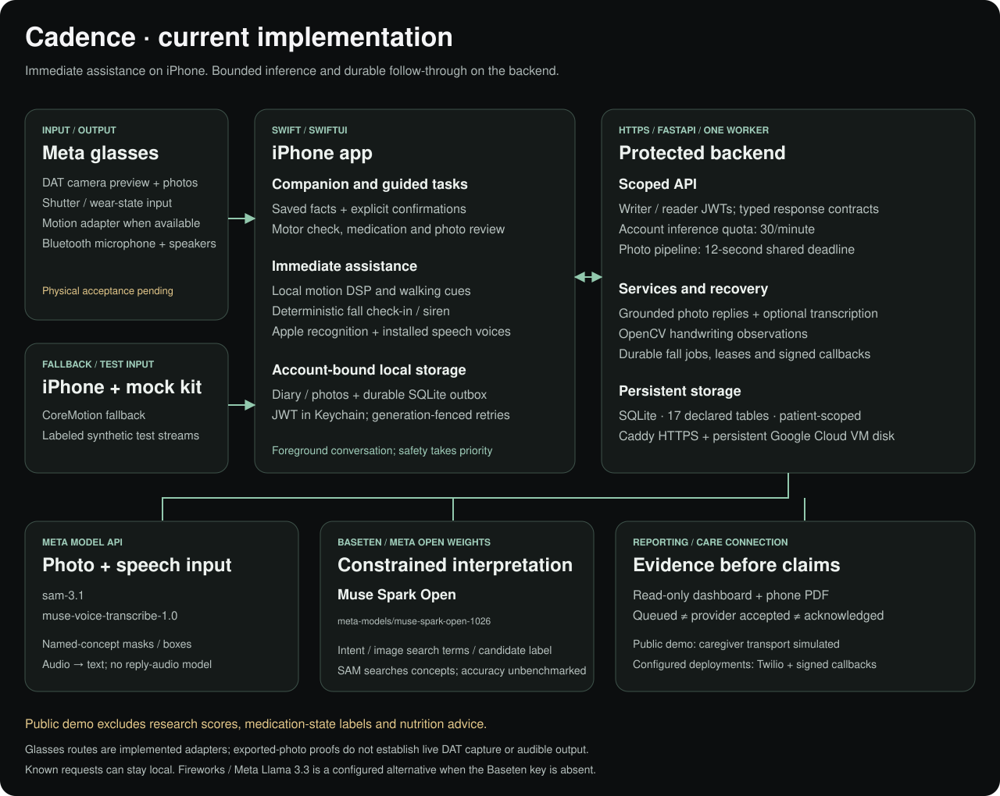

# Cadence

[](https://github.com/theloopsmith/Cadence/actions/workflows/ci.yml)

**Your day. Still yours.** A voice-first iPhone companion for everyday life with Parkinson’s, paired with Meta glasses for available camera, audio and motion capabilities.

[Try the experience](https://cadence-companion.duckdns.org/walkthrough) · [How it works](https://cadence-companion.duckdns.org/walkthrough#how-it-works) · [Care dashboard](https://cadence-companion.duckdns.org/dashboard) · [Video demo (YouTube)](https://youtu.be/SCIVcCh8lok)


[Static overview](docs/assets/architecture.svg)

## Build for Your World

Competition track: **Indie Developer** (owner confirmed).

Cadence helps people living with Parkinson’s carry out everyday routines by voice. The project combines guided tasks, local walking cues, confirmed photo descriptions, and an activity diary in one flow. The repository records the Cadence app, backend, and walkthrough work. It reuses Meta models and the DAT SDK, Apple system speech and sensing, OpenCV, SQLite, and other established dependencies. See the [submission declarations](docs/SUBMISSION_DECLARATIONS.md) for scope and provenance.

## What it does

- **Guided motor check:** a voice sample, a slowly dictated handwritten sentence and an optional short walk. Skipped or unavailable tasks stay distinct from measurements.
- **Medication routine:** reminders of a saved prescribed schedule, factual history questions, and dose logging after explicit confirmation. Meal logging shares a timestamp; optional reviewed photos and notes stay on the phone.
- **Walking support:** local motion processing triggers bounded rhythmic cues. Walking protection on/off is the first action on Today.
- **Surroundings:** review a glasses photo, confirm its use, then hear tentative object labels from the photo check. Detections can be wrong; this does not verify a scene or its safety.
- **Care connection:** possible-fall check-ins, an account-bound offline queue, and a read-only diary/dashboard that separates queued alerts, provider acceptance and human acknowledgment.

Say “start a motor exam,” “help with my medication,” “check my surroundings,” or “I need help.” The foreground companion guides the current task and asks for separate confirmation before sensitive actions. [App setup and voice guide](docs/APP_GUIDE.md).

Cadence is an accessibility prototype. It does not diagnose, recommend medication or nutrition changes, or establish that a scene is safe. The public demo simulates caregiver delivery; it is not an emergency response service.

## Try the demo

The web tour is illustrative: **motor check → medication → walking → surroundings → care**. The separate judge panel runs live Meta inference on fixed demo inputs. The read-only dashboard shows previously seeded synthetic records.

Use **1-Click Judge Sign-In**, or `demo-reviewer` / `cadence-demo-2026` for the read-only dashboard. The live tiles accept only predefined samples and require no sign-in. The temporary dashboard account and live demo expire at **2026-11-18 08:00 UTC**. [Deployment and access details](docs/GOOGLE_CLOUD_DEMO.md).

## Architecture



[Open the implementation map](docs/assets/system-architecture.svg) · [Editable five-page diagram](docs/cadence_architecture.drawio) · [Architecture, math and data contracts](docs/ARCHITECTURE_AND_DESIGN_SPEC.md)

Swift owns sensing, speech, confirmations and local records. FastAPI owns bounded inference, authenticated storage and durable alert recovery. The cloud demo uses Caddy HTTPS, one Uvicorn worker and SQLite on a persistent Google Cloud VM disk. Provider keys stay on the server.

**Runtime models:**

- **SAM 3.1** (`sam-3.1`, Meta Model API): named-concept segmentation for confirmed photos.
- **Muse Spark Open** (`meta-models/muse-spark-open-1026`, Baseten): allowlisted intent interpretation and image search terms and selection from SAM-grounded labels.
- **Muse Voice Transcribe** (`muse-voice-transcribe-1.0`, Meta Model API): optional online speech-to-text.

Handwriting uses OpenCV for letter-height measurement. An optional Muse Spark Open photo review checks for framing, glare, blur or multiple lines. The [live judge run](https://cadence-companion.duckdns.org/walkthrough#live) has separate live tiles for intent, surroundings, handwriting photo quality, and speech transcription.

Installed Apple voices speak replies; Apple on-device recognition, CoreMotion/Accelerate, OpenCV and SQLite are platform/software components. All external runtime model calls use Meta models. The public demo uses Muse for intent classification. If Baseten is unavailable, Cadence returns its local fallback. A Fireworks-hosted Meta Llama 3.3 alternate is available outside public demo when the Baseten key is absent. Models cannot invent diary facts or directly execute actions.

## Run locally

Use Python 3.13 and Xcode with iOS Simulator support. From a clean clone:

```sh
python3 -m venv backend/.venv
backend/.venv/bin/pip install -r backend/requirements-lock.txt
cp backend/.env.example backend/.env
```

Add provider keys to the local `backend/.env` to enable online inference. Keep that file private. Then start the Mac server:

```sh
python3 scripts/run_phone_backend.py
```

Keep the Mac and iPhone on the same Wi-Fi. Install `ios/App/CadenceCompanionApp.xcodeproj`, open **Settings → Advanced → Show developer tools → Find my Mac server**, select the Mac and sign in using `.local/phone-login.txt`. `localhost` on the iPhone means the iPhone itself. This launcher uses account sign-in and simulated caregiver delivery. [Camera, permissions and troubleshooting](docs/APP_GUIDE.md).

## Validate

```sh
backend/.venv/bin/python -m pytest -q backend/tests
CADENCE_TEST_SILENT_AUDIO=1 ./scripts/test_ios.sh
python3 scripts/sync_architecture_docs.py --check
python3 scripts/check_docs.py
```

CI also runs silent walkthrough/math checks, an isolated dashboard browser-security check and an iOS app build with the pinned Meta DAT SDK.

## Evidence and limits

Live SAM + Muse analysis is recorded for an approved [iPhone photo](docs/verification/real-photo-meta-2026-11-01.json) and an [exported glasses photo](docs/verification/glasses-photo-meta-2026-11-01.json). Separate traces cover [Meta intent interpretation](docs/verification/muse-intent-live-2026-11-01.json) and [Muse transcription](docs/verification/muse-transcribe-live-2026-10-29.json). Private photos are not published.

Photo traces demonstrate that the APIs ran, not recognition accuracy. The prototype searches at most six concepts per photo and filters segmentation boxes; these heuristics have not been evaluated on a representative image set. A returned box, including one without a confidence value, is not proof of the object’s identity.

These checks do not establish live DAT capture, audible physical-glasses output, locked-screen continuity or real caregiver delivery. Organizer scope/contribution-date approval and the final submission package remain pending. Experimental scoring, medication-state inference and protein estimation have been removed; simulated task sources are labeled throughout reports.

[Submission declarations](docs/SUBMISSION_DECLARATIONS.md) · [Documentation index](docs/README.md) · [Verification log and remaining checks](docs/VERIFICATION_LOG.md) · [Static artwork provenance](docs/WALKTHROUGH_DESIGN.md)

## License

Cadence's original source code is licensed under the [Apache License 2.0](LICENSE). Copyright 2026 Cadence contributors. See [NOTICE](NOTICE) for scope. Third-party dependencies, Meta models and SDKs, services, and third-party documentation and assets retain their own licenses and terms. [Static artwork provenance](docs/WALKTHROUGH_DESIGN.md).
