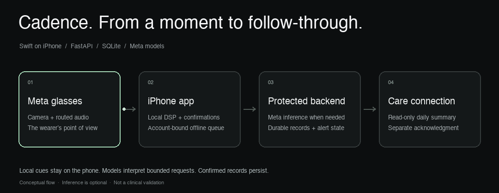

# Cadence — Daily Living & Accessibility Companion

[](https://github.com/theloopsmith/Cadence/actions/workflows/ci.yml)

**Your day. Still yours.** An iPhone companion for everyday life with Parkinson’s, paired with Meta glasses for camera and audio.

[Experience a day with Cadence](https://cadence-companion.duckdns.org/walkthrough) · [Animated “How it works”](https://cadence-companion.duckdns.org/walkthrough#how-it-works) · [Care dashboard](https://cadence-companion.duckdns.org/dashboard) (sign-in required)



[Static architecture diagram](docs/assets/architecture.svg) · [Detailed architecture](docs/ARCHITECTURE_AND_DESIGN_SPEC.md)

## How it works

1. **Glasses capture the moment.** The wearer’s camera view and active audio route connect to the iPhone. The app, not an in-lens HUD or the built-in Hey Meta assistant, owns the Cadence conversation.
2. **The iPhone handles immediate assistance.** Swift runs motion processing, guided tasks, installed Apple speech output, confirmations, and an account-bound offline queue. Phone motion is the fallback when glasses motion is unavailable.
3. **The backend adds bounded inference and persistence.** Authenticated FastAPI routes use Meta models when needed, save events in SQLite, and recover unfinished alert work. Models do not directly execute user actions or invent patient facts.
4. **The care connection keeps the evidence.** A read-only dashboard presents saved observations. Queued work, provider acceptance, delivery status, and a human acknowledgment are separate facts.

### Which model does what?

- **Meta Muse Spark Open** (`meta-models/muse-spark-open-1026`, hosted by Baseten): classifies conversational requests into an allowlisted intent; can choose a scene label only from SAM-grounded candidates. The phone answers factual questions from its saved records and owns action confirmations.
- **Meta SAM 3.1** (`sam-3.1`, Meta Model API): segments named concepts in the user-confirmed photo. Mask filtering and constrained templates keep the description tied to image evidence. A missing detection is not proof that the scene is safe.
- **Meta Muse Voice Transcribe** (`muse-voice-transcribe-1.0`, Meta Model API): optional online speech-to-text. Spoken replies use installed Apple voices in the app and browser speech synthesis in the tour; this model does not generate reply audio.
- **Configured alternate:** Meta Llama 3.3 through Fireworks can interpret requests when the Baseten key is absent. It is not an automatic network retry after a Muse failure. Llama 3.2 vision adapters remain in the repository; the current surroundings path uses SAM plus bounded label selection.

Hosting and model authorship are distinct. CoreMotion/Accelerate, OpenCV, Apple OS features and SQLite are ordinary software/platform features, not additional external model calls. No ElevenLabs model is used. IDs are configurable for development; the public submission demo refuses unreviewed model IDs or enabled research metrics at startup.

### The math, at a glance

**Walking support / FoG.** A Hann-windowed FFT splits available motion into step-band power (0.5–3 Hz) and higher-band power (>3–8 Hz):

`Freeze index = higher-band power / (step-band power + 0.000001)`

The ratio alone does not trigger a cue. Walking/initiation/turn context, an energy floor, speech adjustment and three qualifying 0.5-second hops gate an episode. Cues are bounded and run locally. These experimental thresholds are not diagnostic measures. [Detector source](ios/CadenceCompanion/DSP/FoGDetector.swift).

**Handwriting.** OpenCV thresholds and deskews the photo, finds connected ink components, orders them left to right, and compares the first and last groups (roughly a third each, at least two components):

`Height change (%) = (ending average − starting average) / starting average × 100`

For example, 40 px → 32 px gives −20%. Fewer than four accepted components is unreadable, not a perfect result. Perspective and joined writing affect the measurement. SAM is not the primary handwriting engine, and research scores are hidden by default. [Handwriting source](backend/app/services/handwriting.py).

**Voice.** A five-second sustained vowel supplies RMS amplitude, `dBFS = 20 × log10(RMS)`, and variability as the standard deviation of level samples. Quality gates distinguish a usable sample from silence or an unavailable measurement. [Voice source](ios/CadenceCompanion/DSP/VoiceMonitor.swift).

**Other features.** Possible falls use deterministic impact/jerk/orientation rules and a check-in/escalation state machine. Medication uses saved schedules, explicit confirmation and timestamps; it does not recommend a dose or infer ingestion. The guided walking task records local movement observations. Skipped/unavailable tasks remain distinct from measured tasks.

The web architecture tab has interactive **synthetic** spectra and stroke-height examples. Its diagrams do not capture sensors or call models. The wearer tour is illustrative; its separate authenticated judge panel makes a real Meta intent request and saves labeled synthetic records. Physical-device/glasses acceptance and real caregiver delivery are tracked separately in the verification log.

---

Docs: [architecture diagram](docs/cadence_architecture.drawio) (four pages: system overview, fall safety path, Meta model calls, data and sync) · [readiness review and open items](docs/HACKATHON_READINESS_REVIEW_2026-10-29.md) · [verification log](docs/VERIFICATION_LOG.md) with the evidence behind every claim below.

Cadence is an audio-first accessibility companion for a paired iPhone and Meta AI glasses, built for the Meta Global AI Developer Hackathon's **Build for Your World** problem statement.

It supports rhythmic walking cues, suspected-fall check-ins, attempts to contact a configured caregiver, user-requested descriptions of objects in a photo, and routine logging. Scene descriptions are limited observations, not proof that a room is safe. A queued alert does not mean a caregiver has received it.

## Current product scope

- **Walking cues:** local motion processing and a rhythmic beat; phone motion is the fallback when glasses motion is unavailable. Detector thresholds are experimental, not validated measures of health.
- **Fall check-in:** a 30-second voice/button check-in. Distress escalates immediately; spoken affirmatives remain provisional through the window. Cancellation rearms sensing. Alerts are saved locally and retried when remote dispatch is unavailable. A caregiver response is separate from provider acceptance.
- **Describe surroundings:** on-demand camera input, Meta segmentation, constrained object descriptions, and explicit uncertainty. No diagnosis or categorical absence/safety claim.
- **Routine diary:** reminders of an existing prescribed schedule, factual activity/task measurements, and meal timestamps. Meal logging does not estimate nutrients or advise on medication absorption or timing.
- **Daily summary:** counts and raw measurements. Derived medication states, symptom scores, and nutrition/conflict outputs are excluded by default (`ENABLE_RESEARCH_METRICS=false`). Legacy experimental formulas and API identifiers remain for compatibility; the optional research mode is outside the accessibility submission scope.

This scope is a product boundary, not a statement of organizer approval. The supplied guide lists medical-advice and nutrition-coaching anti-project examples. An organizer clarification is drafted in the [verification log](docs/VERIFICATION_LOG.md#scope-and-positioning-oct-29); it has not been sent. No inference provider, physical hardware path, or real caregiver delivery should be described as verified solely because its configuration or mock tests work.

## Run and test

The wearer interface follows the web experience: a dark graphite canvas, mint accents, readable cards and three tabs—**Today**, **My routine**, and **Settings**. Today keeps medication and guided tasks together; the diary is a home-screen action, device details expand when needed, and **I need help** stays within reach. Spoken commands remain available without navigating the tabs.

### Clean clone setup
```bash
git clone https://github.com/theloopsmith/Cadence.git
cd Cadence
python3 -m venv backend/.venv
backend/.venv/bin/pip install -r backend/requirements-lock.txt
cd backend && .venv/bin/python -m pytest -q && cd ..
CADENCE_TEST_SILENT_AUDIO=1 ./scripts/test_ios.sh
```

For a physical iPhone on the Mac's Wi-Fi, run `python3 scripts/run_phone_backend.py`. It starts a LAN development server on port 8001, prints the address to enter in iPhone Settings, and keeps phone-login credentials in ignored `.local/phone-login.txt`. Real caregiver SMS/calls are disabled in this server.

`localhost` in the iPhone app refers to the iPhone, not the Mac. Use the printed `.local` hostname or the Mac's LAN IP. The updated Settings flow can repair an existing localhost binding while preserving the phone's history and queued events.

```bash
./scripts/run_demo.sh
# Open http://127.0.0.1:8000/dashboard
cd backend && .venv/bin/python -m pytest -q
cd .. && ./scripts/test_ios.sh
./scripts/run_ios_sim.sh
```

Live Meta Model API checks (sanitized traces, no keys or media): [SAM 3.1 over the Responses API](docs/verification/sam-live-2026-10-29.json) and [Muse Voice Transcribe](docs/verification/muse-transcribe-live-2026-10-29.json), both October 29. Re-run the SAM check with `backend/.venv/bin/python scripts/sam_smoke.py [photo.jpg concept ...]`. A single SAM call measured 1–3.6 s; the reality check sends up to five concepts in parallel (about 2.2 s). A [live Muse Spark Open intent trace](docs/verification/muse-intent-live-2026-11-01.json) records Baseten hosting, the exact configured variant, and latency. Real-photo SAM plus Muse label selection remains unverified until a consenting non-sensitive photo is supplied.

Configure backend provider credentials and caregiver contacts locally. Production never substitutes simulated Twilio success for missing credentials; the API returns a retryable failure. Local development/demo may use visibly simulated transports. Automated contacts are currently configured on the server for a single-wearer deployment; the phone's caregiver number configures its manual dialer and does not change server routing.

The repo is inside iCloud Drive; Swift scratch builds should live outside it to avoid code-signing metadata errors. The test script uses a cache directory for this purpose.

## Architecture and delivery status

Swift owns motion sensing, audio, check-ins, and an offline event queue. FastAPI owns authenticated storage and caregiver orchestration. Provider adapters isolate external inference and transport. Emergency decisions remain deterministic.

- [Architecture diagram](docs/cadence_architecture.drawio): open in draw.io; page 1 is the system overview, page 2 the fall safety path, page 3 the Meta model calls, page 4 data, identity and sync.
- [Readiness review](docs/HACKATHON_READINESS_REVIEW_2026-10-29.md): current priorities, the October 30 review pass, and what is still open.
- [Verification log](docs/VERIFICATION_LOG.md): one entry per workstream with the evidence observed and its limits; raw traces in [docs/verification](docs/verification).

The supplied brief requires a public repository, an accessible three-minute video, and clear attribution of work created during the event. Its stated submission deadline is November 4, 2026 at 6 PM Pacific. Signed-out public repository access was verified November 1. Video access, submission completion, contribution timing and final eligibility still require confirmation.

### Connect an iPhone and open the glasses camera

Start the Mac backend with `python3 scripts/run_phone_backend.py` and leave the Mac awake on the same Wi-Fi as the iPhone. Install the latest app build through `ios/App/CadenceCompanionApp.xcodeproj`. In the app, open **Settings → Find my Mac server**, select your Mac, then sign in using `.local/phone-login.txt`. Allow Local Network access. If discovery fails, enter the address printed by the launcher; check its `/health` URL in iPhone Safari first. This local development setup uses simulated caregiver delivery.

Choose **Today → Walking support & glasses → Glasses camera** to see the glasses video. Pair/register the glasses in Meta AI, enable Developer Mode where required, and grant camera permission. Medication setup uses that same camera: capture, review, then **Use this photo** to put the pill reference on Today. The phone shutter works in the camera screen; glasses shutter short presses are supported when DAT exposes that input. Photos taken outside the Cadence camera session are not automatically imported. Live video and local medication photo saving do not require the backend; online analysis/sync does.

### Questions inside Cadence

With the foreground voice companion listening, ask “When is my next dose?”, “What are my medication times?”, “Did I take my medication today?”, “When did I last take [saved medication name]?”, “What were my last motor check results?”, or “Has my caregiver responded?” You can follow a dose-history answer with “What about yesterday?” Known question phrases use deterministic app logic and this phone's saved information without a backend request. With online interpretation enabled, unfamiliar wording can be classified by Meta Muse Spark Open into an allowlisted read-only question, including today/yesterday scope. The model supplies no patient facts: the phone reads records and constructs the factual answer. Neither path requires Meta AI connector approval or executes calls or creates dose records. They are spoken with the installed Apple voice and shown in the companion's reply area. Voice input still uses the existing OS permissions and configured Apple/optional Meta transcription path.

Dose answers distinguish a recorded event from proof of ingestion. Latest-dose lookup covers the last 30 local calendar days; today/yesterday are separate queries. Unreadable history is reported as unavailable. Next-dose answers describe configured reminder times rather than recommending another dose. Caregiver answers distinguish a last-observed verified acknowledgment from provider acceptance or an ordinary dialer call. Questions cancel pending action confirmations, so a later “yes” cannot execute an earlier request.

### Voice companion and model provenance

Organizer clarification supplied during development: **every runtime model call must use a Meta model**. Supplementary AI voice services such as ElevenLabs are not allowed. Built-in OS/browser speech output is permitted. Cadence follows that distinction:

- **Meta model calls:** SAM 3.1 for requested image observations and Muse Voice Transcribe for optional online transcription, through Meta Model API; Muse Spark Open (`meta-models/muse-spark-open-1026`) through Baseten for conversational intent interpretation; existing Meta Llama integrations through Fireworks where configured. The configured Llama 3.3 endpoint returned 404 in the October 29 check, so the companion prefers the verified Muse Spark Open path when Baseten is configured. Provider hosting is separate from model authorship.
- **OS features, not external model API calls:** `AVSpeechSynthesizer` speaks replies using installed Apple voices; Cadence selects Premium, then Enhanced, then Standard, subject to an explicit saved voice choice. Apple's Speech framework supplies on-device-only transcription; server-side Apple recognition is not enabled. iOS Bluetooth/audio routing carries microphone and spoken audio to/from the actual active route. No ElevenLabs or other non-Meta speech model is called. MMS TTS is not currently integrated.
- **Local software:** CoreMotion sampling, motion/speech measurements, deterministic safety decisions, medication schedule lookup, SQLite queues, diary files and OpenCV handwriting measurements run locally or as ordinary backend code. Twilio is a communication service, not a model; provider acceptance is separate from human acknowledgment.

On first open, allow Microphone and Speech Recognition to use the hands-free companion. Cadence defaults to automatic voice startup when no choice has been saved. An explicit voice-off choice is preserved; re-enable it under **Settings → Hands-free voice companion**. Listening is visibly indicated and requires OS permission. Try “I need help,” “start a motor exam,” “help with my medication,” or “check my surroundings.” Generic help asks which kind; model interpretation never directly performs an action. A dose record, Undo, calls and protection changes require a separate clear confirmation. “Cancel” stops the current flow; “stop listening” disables voice mode. During photo review, say “use it” or “retake”; unclear replies repeat the current step instead of reopening the main menu.

The motor flow accepts “start,” “ready,” “skip,” and “finish.” The voice step prepares the microphone before a spoken start cue and then records five seconds; insufficient voice can be retried or skipped. Handwriting uses a displayed sentence dictated slowly in three phrases with pauses; say “repeat” or use the replay button to hear it again. Walking waits for its start cue and offers retry/skip when motion data is insufficient. Leaving or backgrounding cancels active measurement rather than saving a partial recording. The camera accepts “capture,” “use this photo,” “retake,” and “retry.” A spoken capture request in surroundings/handwriting/medication opens the glasses camera and captures once video is ready; using the image still requires confirmation. Medication help reads saved routine/history facts and never changes a prescribed dose. Meal logging records time only. Calls open the iOS dialer, which may require an OS confirmation.

**Using Hey Meta:** Cadence's active glasses microphone can occupy the Bluetooth hands-free route, which may cause Meta AI to ask you to hang up a call. Say “let me use Meta” while Cadence is listening. Cadence closes its voice input and camera session and releases its audio route. Then use Hey Meta normally. Say “Siri, open Cadence” to return; Cadence resumes listening when it becomes active. The iPhone may require unlocking. The companion bar displays status without everyday voice-control buttons. Cadence voice, camera and walking audio are unavailable during this handoff; do not rely on them while using Hey Meta. A fall alert automatically reclaims Cadence audio for its check-in and siren. The everyday companion listens while Cadence is foregrounded; backgrounding pauses it. Native “Hey Meta” wake/launch integration from Cadence, locked-screen operation and conversational barge-in are not implemented or claimed. Fall check-ins preempt everyday voice; phonation recording waits for the everyday microphone to close. Physical glasses microphone/output routing and the complete voice-guided journey still need device acceptance testing.

For a more natural built-in voice, use iPhone Settings → Accessibility → the spoken-content/read-and-speak voice settings → Voices → English and download a Premium or Enhanced voice (labels vary with iOS). Return to Cadence Settings → Voice & Audio Cues → **Automatically use the best installed voice**, or choose and audition a voice. Cadence refreshes its voice selection after returning to the foreground. Downloading voices is an iPhone setting; Cadence cannot install them itself.

If an online check returns 401, sign in again to the same server/account; do not erase the local profile. The surroundings screen can retain the photo in memory while opening its sign-in sheet, then retry that photo. The Mac phone-server launcher now persists a private signing key in `.local/phone-jwt-secret`, so future restarts through that launcher keep newly issued login tokens valid. The first move from an older ephemeral signing key requires one fresh sign-in. Never commit or share that key or `.local/phone-login.txt`.

Implementation evidence, runtime model provenance and remaining device limits: [verification log](docs/VERIFICATION_LOG.md#voice-companion-and-hey-meta-handoff-oct-2930).

Developer controls are hidden by default under **Settings → Advanced → Show developer tools**. Enabling the toggle reveals focused pages for diagnostics, walking replays, calibration, safety tests, medication tests, camera checks, hardware, diary fixtures and the offline queue. There is no Developer tab. The toggle is saved for this local profile; explicit developer launch flags can supply its initial default.

Manage medication reminders from **Today → Edit routine** or **Settings → Medications**. Add each medication and its prescribed reminder times, then choose **Save medications**; Cancel discards draft changes. Today’s selector chooses which medication the Taken/Undo controls refer to. By voice, say “I took [saved medication name]” or “record my dose.” When several medications are saved, Cadence asks for the full saved name before proceeding, then requires a separate confirmation before logging. Ambiguous names are never guessed; “call my caregiver” can interrupt the selection. Reminders are scheduled for all saved medications. Recording a dose dismisses its delivered notification while preserving daily reminders for future days, even if the app is not reopened. If you record a dose before its reminder time, that day’s reminder may still appear; its text asks you to check your saved schedule and dose record before acting. Undo keeps the repeating reminders intact. If iOS rejects a reminder update, **Settings → Medications** shows a failure message and **Retry reminders**. Disabled notifications show guidance to enable Cadence notifications in iPhone Settings. Valid existing reminders survive a failed update; reminders for removed medications/times are cleared. **Get help** contains calling actions; setup is outside that screen.
