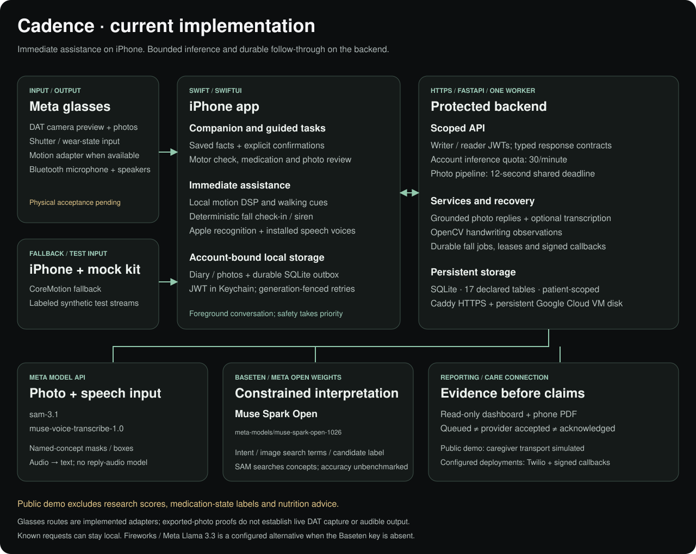

# Cadence architecture and design contract

Cadence is a foreground voice companion on iPhone, paired with Meta glasses for available camera/audio capabilities. Immediate sensing, confirmations and safety decisions stay on the phone. Authenticated FastAPI services add bounded Meta inference, durable records and care-team reporting.

This document describes implemented paths. Physical glasses capture/audio acceptance, locked-screen continuity and real caregiver delivery remain separate evidence gates. The public cloud demo simulates caregiver delivery.

## System map



Open [the editable five-page diagram](cadence_architecture.drawio) for the system overview, fall safety path, model calls, data/privacy flow and generated storage schema. The [animated website guide](https://cadence-companion.duckdns.org/walkthrough#how-it-works) explains these boundaries for judges.

## Ownership

- **Glasses adapter:** the pinned Meta DAT SDK supplies supported camera, audio-route, motion and input capabilities. Bluetooth pairing alone does not establish app access. `GlassesSessionManager` displays actual capability/readiness; phone motion is the fallback. Mock-kit inputs remain labeled simulated.
- **iPhone:** `CadenceAppModel` coordinates foreground `VoiceCompanion`, guarded task flows, local DSP, medication reminders, diary files and account/destination-bound sync. Known spoken questions use saved facts. Models do not create patient facts, place calls or write dose records.
- **Backend:** scoped writer/reader authentication, image/audio validation, constrained inference, event persistence, a fall-job recovery loop and consistent report snapshots. `backend/app/main.py` remains the route layer; service and client modules own the underlying work.
- **Care connection:** dashboard/PDF observations and separately tracked alert states. Queued, provider-accepted, delivered and human-acknowledged are different facts. A call opened in the phone dialer is not a verified server acknowledgment.

The current public deployment is one e2-small VM with Caddy HTTPS, one Uvicorn worker and durable SQLite. A local Mac server remains available for same-Wi-Fi development. Provider keys stay on the server. See [deployment and security](GOOGLE_CLOUD_DEMO.md).

## Models and local software

**Meta SAM 3.1** (`sam-3.1`) uses the Meta Responses API. Each requested concept is a separate parallel call, under a six-second stage and shared twelve-second interactive budget. `sam_output.py` decodes boxes and masks; unanswered concepts produce explicit partial/unavailable status; valid masks from successful calls remain usable without claiming the whole scene was verified. Missing confidence is distinct from stated low confidence.

Ordinary scene evidence requires at least 1.5% frame area and rejects stated confidence below 0.65. A small inanimate object explicitly named by the wearer may qualify with stated confidence at least 0.8 and a valid box with sides of at least 16 pixels. These are prototype heuristics, not calibrated accuracy or safety guarantees. The response records which grounding rule accepted each object. Small unrequested objects retain the conservative gate.

**Meta Muse Spark Open** (`meta-models/muse-spark-open-1026`), hosted by Baseten, proposes up to three vocabulary-bound object terms from a 640px thumbnail for general photo questions. Image content follows [Meta’s hosted Muse content-part format](https://github.com/meta-models/meta-oss-cookbook/blob/main/muse-spark/hosted/baseten.md). Proposal runs alongside initial living-subject SAM probes; object terms must then pass independent SAM grounding. Named-object questions skip proposal. Discovery has a seven-second cap within the shared deadline and its own circuit-breaker key; optional vision failure cannot disable text interpretation. It also classifies a bounded intent or selects one complete label from SAM-grounded candidates. Low reasoning and a 512-token allowance leave room for a final answer. Image-label selection has a three-second wall-clock maximum, clamped by the shared remaining budget. Invalid, unavailable or late output uses deterministic wording/evidence. It does not become an invented label. Request metadata identifies actual model/provider success separately from fallback.

The configured **Meta Llama 3.3** Fireworks path is an alternate when the Baseten key is absent, not an automatic retry after a Muse failure. Legacy Llama vision adapters remain in the source; the current photo route uses SAM and bounded selection. Public-demo startup pins the reviewed model IDs. Development configuration is separate from the submitted demo.

**Meta Muse Voice Transcribe** (`muse-voice-transcribe-1.0`) provides optional online transcription. Apple's on-device recognizer and installed Premium/Enhanced/Standard voices are OS features. Spoken replies use `AVSpeechSynthesizer`; the browser tour uses browser speech synthesis. No ElevenLabs runtime model is integrated.

**Ordinary local processing:** CoreMotion/Accelerate, OpenCV, SQLite and platform audio/haptic/location APIs. FoG detection and handwriting measurement are not LLM calls.

## Measurement and task contracts

- **Walking cues:** Hann-windowed motion FFT; freeze index = power at >3–8 Hz / (power at 0.5–3 Hz + 0.000001). Walking/initiation/upright-turn context, energy, speech adjustment and repeated qualifying windows gate an episode. Local cues are bounded. Thresholds and source placement are experimental.
- **Handwriting:** OpenCV thresholding, deskew and connected components; compare mean heights in the first/last groups, roughly a third each and at least two components. Change = `(end − start) / start × 100`; negative means smaller. Fewer than four accepted components is unreadable. Only stroke-height observations are computed. Experimental scoring and classifications have been removed. Both readable and unreadable HTTP responses use the same observation projection; iOS has no research-result properties.
- **Voice/walking exam tasks:** quality and measured/skipped/unavailable states accompany nullable values. A partial or interrupted task cannot reuse earlier measurements. Five-second phonation and ten-second walking windows begin after their spoken start cue; handwriting is dictated in three paced chunks.
- **Medication/meal diary:** saved prescribed reminder times, factual history lookup, explicit wearer confirmation and timestamps. Dose Undo is a scoped, idempotent retraction. Meal logging saves a timestamp locally and queues it for sharing. Reviewed optional photos and notes stay local, with an explicit receipt. A 30-day reconciliation repairs diary-to-outbox crash gaps only at the recorded owner/destination/generation; existing pending retry state is preserved. It does not estimate nutrients or recommend medication timing.

## Fall sequence and recovery

```mermaid
sequenceDiagram
    participant P as iPhone
    participant B as Backend + SQLite
    participant T as Configured transport
    participant C as Caregiver
    P->>P: Detect candidate; save locally
    P->>B: Upload candidate when connected
    B->>B: Commit candidate and durable job
    P->>P: Prepare microphone; 30-second check-in
    alt User cancels or sufficiently confirmed response
        P->>B: Cancel at matching owner/generation
    else Distress or unresolved check-in
        P->>B: Escalation request
        B->>B: Commit attempt before provider call
        B->>T: Attempt SMS/call
        T-->>B: Provider acceptance/status
        C->>T: DTMF acknowledgment
        T->>B: Signed callback + matching attempt/SID
    end
    Note over B: 45-second server timeout/recovery applies only after candidate upload
    Note over T,C: Public demo simulates transport; real delivery is unverified
```

Distress from either recognizer wins. Spoken affirmatives remain provisional under the check-in reducer; cloud-only affirmation cannot silently cancel a fall. Button cancellation remains explicit. Safety preempts everyday speech, walking audio and voice measurement. `fall_jobs`, `fall_attempts` and `fall_clear_jobs` support leased, at-least-once recovery; there is no exactly-once external-delivery promise.

A phone with no connection retains its outbox and exposes manual help. No server timer can recover a candidate that never reached the server. Never ask a wearer to induce a fall or provoke a freeze for acceptance testing.

## Data, privacy and erasure

[Open the generated storage schema](assets/storage-schema.svg). It shows fresh-database tables and actual SQL foreign keys from `db.py` and `fall_durability.py`; it is not a dump of wearer data. `patient_id` on observation tables is a logical ownership key, not a users-table foreign key. Legacy research columns do not imply those fields are exposed in the submitted API.

Phone profile storage contains diary files, task history, selected medication reference images, explicitly labeled captures and the SQLite outbox. Meal reference photos live under the profile diary and are removed with local profile reset; server wipe does not remove them. JWTs use Keychain with `AfterFirstUnlockThisDeviceOnly`. Failed local writes are visible and do not become success receipts.

The outbox binds rows to an owner, destination, payload revision and data generation. Server inserts check the erase generation inside the write transaction. A wipe increments that boundary; stale writes receive 409 rather than restoring erased records. Local reset and server wipe are separate actions. A server change cannot silently reassign queued history.

Inference image/audio bytes are transient in the app/backend path. The backend saves bounded labels/masks, query/reply text, measurements and event metadata, not continuous video. Those saved observations and caregiver retry ledgers are sensitive records. Scoped authentication, TLS and optional SQLCipher protect their boundaries; absent encryption/backup controls must not be claimed as implemented. Telemetry retention runs at startup/daily; incident retention and backup/restore acceptance remain open.

Reports use a consistent trailing-24-hour snapshot, explicit coverage/freshness, nullable measurements and capped detail arrays with truncation flags. The dashboard uses text nodes and nonce CSP; read-only accounts cannot mutate. Public API docs/schema routes are disabled.

## Native experience and limits

Today, My routine and Settings are the three root tabs. Today puts walking protection on/off first, before voice status, medication and guided actions. Diary is a home-screen action; glasses/audio diagnostics expand separately. The help footer is inset directly into the scroll view inside NavigationStack so it reserves space instead of covering the final controls. Walking-support failures remain visible. The graphite/mint palette, large guarded targets, Dynamic Type and semantic labels are defined in `DesignSystem.swift`.

Cadence's microphone route and native Hey Meta are separate. A spoken handoff releases Cadence audio/camera; reopening through Siri returns to the foreground companion. Meta connector preview was applied for, but approval and native voice invocation are not integrated. The existing companion does not depend on them. Background/locked-screen conversational operation is not an acceptance claim.

## Keeping diagrams current

Run `python3 scripts/sync_architecture_docs.py` after changing model defaults, native tabs or storage DDL. It updates draw.io labels from source and regenerates the implementation SVG and schema page/SVG without loading secrets or records. `--check` runs in CI. The diagram's four main pages retain editable geometry. The README retains its original animated four-boundary overview; `scripts/generate_architecture_art.py` is its source. Detailed current behavior belongs in the source-checked implementation map.

The [verification log](VERIFICATION_LOG.md) records dated evidence and its limits. The [docs index](README.md) lists current acceptance gates. Neither compilation nor synthetic tests establish physical-device or clinical acceptance.


## Public API and inference guardrails

The research flag and its execution branches have been removed, including motor/composite scores, symptom-burden and medication-state classifiers, protein estimation and the meal-protein route. Legacy database columns remain inert for compatibility; their values are always excluded from reports and cannot be re-enabled by environment configuration. Meal logging records time only; it does not detect protein, evaluate absorption or recommend food/dose timing. Explicit response models cover the report, exam history and photo result (including wiped-event drops). Motor observations carry `measurement_source` plus paired per-task status/source; device source is client-reported, not hardware attestation. The table and serial comparison label simulated and unverified sources.

Everyday paid inference shares an atomic process-local sliding window (default 30/minute per account; local static bearers have separate budgets). Account identity prevents login/token refresh from resetting the quota. Over-limit requests return 429 and `Retry-After` before provider work. Fall-check-in transcription has a separate 60/minute account budget so everyday requests cannot consume its allowance. This is a single-worker throttle that resets after restart, not a billing cap. Default static tokens are empty; the LAN launcher disables them. Default and relative SQLite paths resolve under `backend/`, independent of the shell working directory; deployment's explicit absolute data path remains unchanged.

The iPhone photo transport uses a 20-second request timeout around the 12-second server budget; ordinary requests retain their default timeout. The confirmed image can be retried with a clarified question. Dictation permission/completion callbacks and in-flight results are fenced by operation/profile identity. Medication setup uses a stable draft session, one persistent Save routine action, and an explicit saved summary; partial photo failures keep the editor open.
