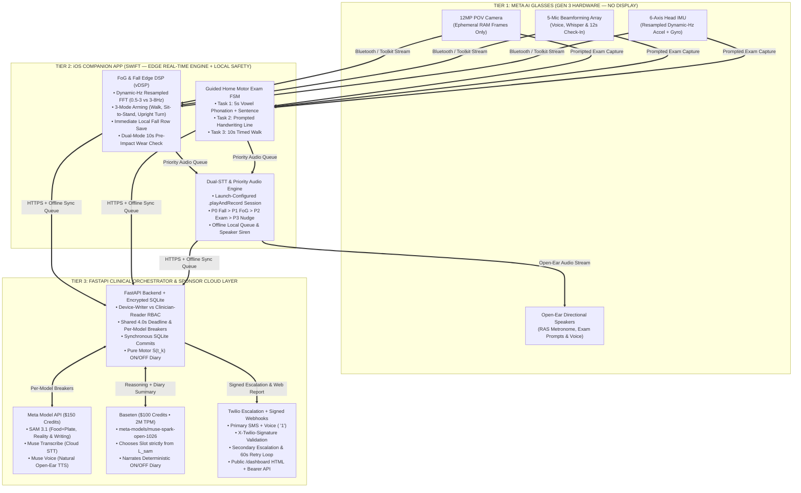

# Cadence: Master System Architecture, Clinical Rules, Inputs & 9-Day Implementation Specification (v1)

> [!IMPORTANT]
> **Hackathon Compliance, Hardware Constraints & Clinical Safety Architecture**
> - **Page 5 Hardware Constraint**: Per the official Meta Global AI Developer Hackathon handbook (Page 5), **Meta Gen 3 AI Glasses have no HUD/display** and apps do **not** run natively on the glasses. All edge signal processing executes on the paired **iOS Companion App** via the **Meta Wearables Device Access Toolkit**, and all user feedback is delivered via **open-ear speakers** (`Muse Voice` / `AVAudioEngine` / `AVSpeechSynthesizer`), with emergency bystander alerts forced out of the **iPhone bottom speaker** (`overrideOutputAudioPort(.speaker)`).
> - **Fail-Safe Safety & Clinical Grounding**:
>   1. **Zero-Latency Safety Critical Path**: Freezing of Gait (FoG) rhythmic cueing (`<50 ms` on-device DSP) and 3-stage Fall Impact Detection execute 100% locally on the iOS companion app with **zero cloud dependency**.
>   2. **Guaranteed Event Persistence & Synchronous Commits**: Every fall candidate is persisted locally in encrypted SQLite (`candidate_check_in_pending`) the millisecond Stage 3 completes—before the 12-second check-in begins. All backend endpoints (`POST /api/v1/events/fog`, `POST /api/v1/events/fall`, `POST /api/v1/exam/complete`, etc.) perform a **synchronous SQLite commit before returning HTTP `200 OK` or calling external APIs**.
>   3. **SAM-Label-Locked Hallucination Reality Check**: In the Hallucination Reality Check pipeline, `SAM 3.1` segmentation masks establish the ground-truth detected label set $L_{\text{sam}}$, and the spoken response slot is restricted **strictly** to inanimate labels present in $L_{\text{sam}}$ for that exact frame.
>   4. **Method-Invariant Scoring & Pure Motor ON/OFF Diary**: Handwriting micrographia scores (`handwriting_score`) and diary symptom burden $S(t_k)$ are computed deterministically from pure motor and biomechanical features, ensuring longitudinal comparability and 100% reproducible clinical state classification (`OFF`, `NO_DOSE`, `WEARING_OFF`, `ON`).

---

## 1. Visual System Architecture Diagrams

The two Draw.io diagrams below use a **3-tier horizontal swimlane topology** and **strict left-to-right pipeline swimlanes** with dedicated bus corridors so **zero arrows cross or overlap**:
- **High-Level System Architecture**: [`cadence_high_level.drawio`](./cadence_high_level.drawio)
- **Detailed Step-by-Step Clinical Pipelines**: [`cadence_detailed_architecture.drawio`](./cadence_detailed_architecture.drawio)



---

## 2. Sponsor Credit Strategy, Per-Model Circuit Breakers & Scope Protection

### 2.1 Core Sponsor Stack & Configurable Model Routing
All external model identifiers are loaded via `pydantic-settings` in `backend/app/config.py` so any endpoint or model string can be swapped via `.env` with zero code changes:

| Sponsor / Platform | Available Credits / Limits | Active Role in Cadence | Config Env Var & Default Model ID |
| :--- | :--- | :--- | :--- |
| **Meta Model API** | **\$150** (`META_API_KEY`) | **Primary Multimodal Core**: `SAM 3.1` segmentation masks (food + plate normalization, hallucination verification, handwriting letter boxes), `Muse Transcribe` STT, and `Muse Voice` TTS. | `META_SAM_MODEL="sam-3.1"`<br/>`META_STT_MODEL="muse-transcribe"`<br/>`META_TTS_MODEL="muse-voice"` |
| **Baseten** | **\$100** (`BASETEN_API_KEY`, **2M TPM**) | **Primary High-Throughput Reasoning & Clinical Summarizer**: Runs `muse-spark-open-1026` at `https://inference.baseten.co/v1` to select from SAM-verified labels $L_{\text{sam}}$ and narrate the deterministic $S(t_k)$ ON/OFF diary & Home Motor Exam report. | `BASETEN_MODEL="meta-models/muse-spark-open-1026"` |

### 2.2 Shared `4.0 s` Request Deadline & Per-Model 3-Strike Circuit Breakers
To guarantee interactive response times on the glasses and prevent cross-service cascading failures:
1. **Shared `4.0 s` Request Deadline (`RequestDeadlineContext`)**: Every cloud-assisted interactive pipeline (Pipelines 3, 4, 5, and 6) initializes a request-scoped `deadline = time.monotonic() + 4.0`. Each downstream stage receives `min(stage_budget, remaining_budget)`:
   - **Stage A (`SAM 3.1`)**: `1.8 s` max budget.
   - **Stage B (Baseten `muse-spark-open-1026`)**: `1.2 s` max budget.
   - **Stage C (`Muse Voice` TTS)**: `0.8 s` max budget (if remaining budget `< 0.35 s`, skips cloud TTS and returns text immediately for zero-latency on-device `AVSpeechSynthesizer` playback).
2. **Per-Model 3-Strike Circuit Breakers (`app/clients/circuit_breaker.py`)**:
   - Circuit breakers are keyed by **`(provider, model_id)`** rather than by provider alone:
     - `("meta", "sam-3.1")`
     - `("meta", "muse-transcribe")`
     - `("meta", "muse-voice")`
     - `("baseten", settings.baseten_model)`
   - **Why Per-Model**: If `SAM 3.1` experiences transient latency and trips its 3-strike breaker (`60 s` cooldown), `Muse Voice` and `Muse Transcribe` remain **CLOSED (healthy)** so spoken audio and transcription never degrade unnecessarily.

### 2.3 Protected Demo-Critical Path vs. Secondary Scope Cut List
To ensure the 9-day build finishes on schedule for the **3-minute pitch video**, features are partitioned into a **Protected Demo-Critical Path (`P0`)** and an **Ordered 6-Item Scope Cut List (`P1` / Stretch)**:

- **Protected Demo-Critical Path (`P0` — Never Cut)**:
  1. **Pipeline 1**: Freezing of Gait (FoG) detection (`<50 ms` on-device resampled FFT + 3-mode arming + 100 BPM RAS metronome).
  2. **Pipeline 2**: Fail-Safe Fall Detection + 12s dual-STT check-in + Twilio SMS/Voice `<Gather>` + Launch-Configured `.speaker` Siren & SOS Screen Beacon.
  3. **Pipeline 4**: Verifiable Hallucination Reality Check (`SAM 3.1` $L_{\text{sam}}$-locked grounding gate + Baseten + calm open-ear voice).
  4. **Pipeline 6 & 7**: Guided 3-Step Home Motor Exam + Pure Motor $S(t_k)$ ON/OFF Diary + Web Neurologist Report (`neurologist_dashboard.html`).
- **Ordered 6-Item Scope Cut List (Executed in Order if Schedule Slips)**:
  1. **Cut #1 (Already Executed)**: Skip Modal (`app/clients/modal_vision.py`) and Fireworks (`app/clients/fireworks_llm.py`) optional plugins during the 9-day sprint.
  2. **Cut #2**: Simplify Secondary Caregiver live voice call to SMS-only if Twilio dual-call testing takes `>2 hours` on Day 3.
  3. **Cut #3**: Simplify iOS Onboarding Consent screen to a single-screen toggle sheet if UI polish takes `>2 hours` on Day 2.
  4. **Cut #4**: Cut passive background hypophonia nudges (`VoiceMonitor.swift` ambient mode) while keeping **Guided Home Motor Exam Task 1 (Prompted 5s Voice Check)** 100% intact.
  5. **Cut #5**: Cut passive ambient handwriting nudges while keeping **Guided Home Motor Exam Task 2 (Prompted Handwriting Check)** 100% intact.
  6. **Cut #6**: Cut live pill-bottle camera OCR in Pipeline 3, using the prescribed dose schedule + voice confirmation (`"Took my pill"`) + `SAM 3.1` plate-normalized meal protein check.

---

## 3. Exhaustive Pipeline Specifications: Inputs, Rules & Design Decisions

### 3.1 Hardware Input Specification & Dynamic-Hz Resampling (`SensorStreamManager.swift`)
- **Required iOS Background Modes (`Info.plist -> UIBackgroundModes`)**: `["audio", "bluetooth-central", "location", "processing"]` so continuous IMU/Bluetooth streaming, open-ear audio cueing, and `CoreLocation` emergency coordinates remain active while the iPhone is locked in the wearer's pocket.
1. **12 MP POV Camera Stream**: Captured as on-demand `1280x720` JPEG frames (`quality = 0.80`, ~`120 KB`) exclusively during active user queries or prompted Home Motor Exam tasks. Held in volatile RAM (`io.BytesIO`) and garbage-collected immediately after inference.
2. **5-Mic Beamforming Audio Stream**: `16 kHz`, 16-bit mono PCM (`AVAudioEngine` input tap). Computed in `100 ms` sliding RMS windows (`1600` samples/window) in dBFS:
   $$L_{\text{dBFS}} = 20 \log_{10}\!\left(\sqrt{\frac{1}{N}\sum_{i=1}^{N} x_i^2} + 10^{-9}\right)$$
3. **6-Axis Head IMU Stream with Real-Time Rate Estimation & Uniform Linear Resampling**:
   - Continuously measures inter-sample arrival timestamps $\Delta t_k = t_k - t_{k-1}$ over a rolling 100-sample buffer to compute the real-time effective sampling rate $\hat{f}_s = 1 / \text{median}(\Delta t_k)$ (typically `50 Hz` or `100 Hz`).
   - **Uniform Grid Resampling**: Before running `vDSP_fft_zrip`, `IMUResampler` linearly interpolates incoming `(timestamp, a_x, a_y, a_z, g_x, g_y, g_z)` samples onto a **strictly uniform time grid** at $\Delta t = 1/\hat{f}_s$, eliminating Bluetooth packet-arrival jitter and spectral leakage across the `3.0 Hz` locomotor/freeze boundary.
   - Dynamically selects the power-of-2 FFT window length covering $\approx 2.56\text{ s}$ with a fixed **`0.50 s` sliding hop** ($\Delta t_{\text{hop}} = 0.50\text{ s}$, i.e., `50` samples at `100 Hz` or `25` samples at `50 Hz`):
     $$N_{\text{fft}} = 2^{\lceil \log_2(2.56 \cdot \hat{f}_s) \rceil}, \quad \Delta f = \frac{\hat{f}_s}{N_{\text{fft}}}, \quad \Delta t_{\text{hop}} = 0.50\text{ s}$$
     *(At $\hat{f}_s = 100\text{ Hz}$, $N_{\text{fft}} = 256, \Delta f = 0.3906\text{ Hz}$; at $\hat{f}_s = 50\text{ Hz}$, $N_{\text{fft}} = 128, \Delta f = 0.3906\text{ Hz}$. Three consecutive hops equal exactly $3 \times 0.50\text{ s} = 1.50\text{ s}$.)*

---

### 3.2 Audio Priority Arbitration & Launch-Configured Audio Session (`AudioCueEngine.swift`)
Because a user could experience a gait freeze or fall while a lower-priority voice prompt is playing, `AudioCueEngine.swift` enforces a **4-level preemptive priority queue** and configures the iOS audio session **once at app launch**:

| Priority Level | Event Class | Preemption Rule | Output Route |
| :---: | :--- | :--- | :--- |
| **Priority 0 (Highest)** | **Fall Check-In Prompt & Bystander Siren** | Immediately preempts and cancels P1, P2, and P3 audio. | Check-in on glasses (`0.85` vol); **Bystander Siren forced to iPhone bottom speaker (`0 dBFS`)**. |
| **Priority 1** | **Freezing of Gait (FoG) 100 BPM RAS Metronome** | Preempts P2 and P3 immediately (`<50 ms`). Only preempted by P0 Fall Alert. | Open-ear glasses speakers (`AVAudioEngine` PCM buffer). |
| **Priority 2** | **Guided Home Motor Exam Prompts & Hallucination Reply** | Preempts P3 ambient nudges. Pauses/waits if P1 FoG metronome is active. | Open-ear glasses speakers (`Muse Voice` or `AVSpeechSynthesizer`). |
| **Priority 3 (Lowest)** | **Ambient Coaching Nudges (Voice Volume, Handwriting, Protein)** | Dropped or deferred (`60 s`) if P0, P1, or P2 is active. | Open-ear glasses speakers (`0.65` vol). |

- **Launch-Configured `.playAndRecord` Session & Hands-Free Profile (`HFP`) Note (`AudioCueEngine.init()`)**:
  - At app startup, `AudioCueEngine.init()` configures `AVAudioSession.sharedInstance()` **once**:
    ```swift
    try session.setCategory(
        .playAndRecord,
        mode: .default,
        options: [.defaultToSpeaker, .allowBluetooth, .allowBluetoothA2DP]
    )
    try session.setActive(true)
    ```
  - During normal operation (P1–P3), audio routes to the paired glasses Bluetooth route while mic capture remains active. Note that when iOS routes bidirectional audio + mic over standard Bluetooth (`HFP`), both input and output operate at `16 kHz` wideband speech—matching our `16 kHz` PCM mic tap assumption and providing clear `16 kHz` speech/metronome output (the Day-2 AM hardware spike verifies whether the Meta Wearables Toolkit uses standard iOS Bluetooth routing or an SDK-managed stream).
  - When the P0 Bystander Siren activates, `activateBystanderSiren()` calls **only** `try session.overrideOutputAudioPort(.speaker)` without changing the session category—preventing iOS from resetting the audio route or dropping active streams.
  - When the siren is canceled, `deactivateBystanderSiren()` calls `try session.overrideOutputAudioPort(.none)` to restore the glasses audio route cleanly.

---

### 3.3 Pipeline 1 (Demo-Critical `P0`): Freezing of Gait (FoG) Detection & Rhythmic Cueing
- **Inputs**: Uniformly resampled vertical ($a_y$) and anterior-posterior ($a_z$) head acceleration at $\hat{f}_s$, yaw gyro ($g_y$), pitch/roll gravity angles ($\theta_{\text{pitch}}, \theta_{\text{roll}}$), and speech activity flag from `VoiceMonitor`.
- **Mathematical Rules (`FoGDetector.swift`)**:
  1. Compute composite dynamic acceleration $a_{\text{dyn}}(t) = \sqrt{a_y(t)^2 + a_z(t)^2} - \bar{a}$ over the $N_{\text{fft}}$ uniform window with a Hann window.
  2. Integrate power spectral density $S(f) = \frac{1}{N_{\text{fft}}}|X(f)|^2$:
     - **Locomotor Band Power ($P_{\text{loco}}$)**: $f \in [0.5\text{ Hz}, 3.0\text{ Hz}]$
     - **Freeze Band Power ($P_{\text{freeze}}$)**: $f \in (3.0\text{ Hz}, 8.0\text{ Hz}]$
     - **Total Dynamic Energy ($E_{\text{total}}$)**: $P_{\text{loco}} + P_{\text{freeze}}$
  3. Compute the **Freeze Index ($FI$)**:
     $$FI = \frac{P_{\text{freeze}}}{P_{\text{loco}} + \epsilon}, \quad \epsilon = 10^{-6}\text{ g}^2$$
  4. **3-Mode Arming State Machine (Eliminates First-Step & Turning Blind Spots)**:
     The detector transitions to `ARMED` in **any** of three clinically high-risk contexts:
     - **Mode A — Active Walking**: $P_{\text{loco}} > 0.08\text{ g}^2$ for $\ge 3.0\text{ s}$.
     - **Mode B — Sit-to-Stand Initiation**: Vertical acceleration surge $\Delta a_y > 0.35g$ combined with pitch transition $\Delta\theta_{\text{pitch}} > 15^\circ$ after $\ge 5.0\text{ s}$ of seated stillness ($E_{\text{total}} \le 0.02\text{ g}^2$), opening a **10-second `INITIATION_ARMED` window** to catch start-hesitation freezes on the very first step.
     - **Mode C — Upright Posture Turn**: Requires **upright head posture** ($|\theta_{\text{pitch}}| \le 35^\circ \land |\theta_{\text{roll}}| \le 35^\circ$, or recent walking within the last `15 s`) **AND** integrated yaw rotation $|\int_{t-1.5\text{s}}^{t} g_y(\tau)\,d\tau| \ge 45^\circ$, opening an **8-second `TURN_ARMED` window** while rejecting supine bed rolls.
  5. **Speech-Coupled Threshold Modifier**:
     Because speaking aloud causes $3\text{–}6\text{ Hz}$ head micro-nods, when `VoiceMonitor.isUserSpeaking == true` ($L_{\text{dBFS}} > -38\text{ dBFS}$), the effective threshold is raised by $+0.8$:
     $$\tau_{\text{FI}} = \begin{cases} 2.8 & \text{if } \text{isUserSpeaking} == \text{true} \\ 2.0 & \text{otherwise} \end{cases}$$
  6. **Trigger Condition**: State is `ARMED` (`WALKING_ARMED`, `INITIATION_ARMED`, or `TURN_ARMED`) **AND** $E_{\text{total}} > 0.02\text{ g}^2$ **AND** $FI > \tau_{\text{FI}}$ for **3 consecutive `0.50 s` hops** (`1.50 s`).
  7. **Action & De-activation**: Triggers Priority-1 `100 BPM` (`1.67 Hz`) auditory metronome click + calm voice prompt (`"Step, step, step"`). Automatically stops when $FI < 1.2$ and $P_{\text{loco}} > 0.08\text{ g}^2$ for `3.0 s` (or max `30 s` cap), then writes to local SQLite and syncs to `POST /api/v1/events/fog`.

---

### 3.4 Pipeline 2 (Demo-Critical `P0`): Fail-Safe Fall Detection & Multi-Channel Escalation
- **Inputs**: 6-axis IMU vector magnitude $\|\mathbf{a}(t)\|$, jerk $\|\dot{\mathbf{a}}(t)\|$, gravity orientation angles ($\theta_{\text{pitch}}, \theta_{\text{roll}}$), Meta Wearables Toolkit hardware `wearState` (`isWorn` primary signal) + pre-impact 10-second circular wear buffer, `CoreLocation` GPS coordinates (`latitude`, `longitude`, `horizontal_accuracy_m`), microphone audio stream, and network reachability.
- **Rules & State Machine (`FallDetector.swift` + `app/services/fall_escalation.py`)**:
  1. **Hardware `wearState` Primary & Day-2 Calibrated Pre-Impact Wear Gate (`ENABLE_UNWORN_DROP_SUPPRESSION = false` by Default)**:
     - **Primary Signal**: Reads the Meta Wearables Device Access Toolkit's native hardware proximity/donning property (`glassesSession.wearState == .worn`).
     - **Secondary Pre-Impact Ring Buffer (`[-12.0s, -2.0s]`, Gated Behind Day-2 Calibration)**: Computes motion RMS ($E_{\text{rms,pre}} \ge 0.04g$) and $[0.15\text{ Hz}, 0.40\text{ Hz}]$ respiration band power ($P_{\text{resp,pre}}$).
     - **Fail-Safe Default (`ENABLE_UNWORN_DROP_SUPPRESSION = false`)**: Unworn-drop suppression is **disabled by default** until the Day-2 AM supine-vs-table recording establishes a verified noise-floor margin. When disabled (`false`), `isWornPreImpact` defaults to `true` unless the hardware toolkit explicitly reports `wearState == .notWorn`.
  2. **3-Stage Biomechanical Impact Filter & Immediate Local Persistence**:
     - **Stage 1 (Free-Fall / Descent)**: $\|\mathbf{a}(t)\| < 0.45g$ for $\ge 60\text{ ms}$.
     - **Stage 2 (Impact Spike)**: Peak $\|\mathbf{a}(t)\| > 2.8g$ and jerk $\|\dot{\mathbf{a}}(t)\| > 35\text{ g/s}$ within `0.5 s` of Stage 1.
     - **Stage 3 (Post-Impact Orientation & Stillness)**: Head orientation changes by $\Delta\theta_{\text{pitch/roll}} > 55^\circ$ and remains still ($E_{\text{total}} < 0.015\text{ g}^2$) for `[0.5s, 2.5s]` post-impact.
     - **Immediate P0 Local Persistence**: The exact millisecond Stage 3 completes, `EventSyncManager.saveLocalImmediate()` writes the fall record (`status = "candidate_check_in_pending"`, including last known `CoreLocation` `latitude`, `longitude`, and `horizontal_accuracy_m`) to local encrypted SQLite before starting the 12-second check-in timer.
  3. **12-Second Dual-STT Voice Check-In, Affirmative Phrase & Groan/Negation Rules**:
     - Plays Priority-0 prompt: *"Hard impact detected. Say 'I am okay' to cancel the caregiver alert."*
     - Runs **Apple `SFSpeechRecognizer` (`requiresOnDeviceRecognition = true`)** in parallel with **`Muse Transcribe` (`1.2 s` timeout)** and an acoustic vocal-activity detector ($L_{\text{dBFS}} > -28\text{ dBFS}$).
     - **Cancellation Rule (`status = "canceled_false_alarm"`)**: Cancelled **only** if the transcript matches an explicit multi-word affirmative phrase: `["i am okay", "i'm okay", "i am fine", "i'm fine", "false alarm", "cancel alert", "do not call", "don't call"]` **with no distress or negation keywords** (`["not okay", "not fine", "no", "help", "hurt", "fell", "can't get up", "pain", "emergency"]`), OR if the wearer taps the large on-screen **"I'M OKAY — CANCEL"** button. *(Bare `"okay"` is excluded so `"Okay... help me"` or `"I'm not okay"` never cancels an alert.)*
     - **Immediate Escalation & Groan Override Rule (`status = "confirmed_waiting_dispatch"`)**:
       - **Distress / Negation Keywords**: If any distress or negation keyword (`"not okay"`, `"not fine"`, `"no"`, `"help"`, `"hurt"`, `"fell"`, `"can't get up"`, `"pain"`, `"emergency"`) is detected, escalates **immediately** regardless of wear state.
       - **Vocal Groan / Non-Word Sound Override**: If the 12-second timer expires and acoustic vocal activity ($L_{\text{dBFS}} > -28\text{ dBFS}$, e.g., groans, moans, or slurred non-word sounds) was detected without an affirmative cancel phrase, escalates **immediately even if `isWornPreImpact == false`**.
       - **Silent Timeout**: If the 12-second timer expires in silence and `isWornPreImpact == true` (or `ENABLE_UNWORN_DROP_SUPPRESSION == false`), updates local SQLite to `"confirmed_waiting_dispatch"` and dispatches to `POST /api/v1/events/fall`. Only if `ENABLE_UNWORN_DROP_SUPPRESSION == true` AND `isWornPreImpact == false` AND 12 seconds of total silence (`< -45 dBFS`) elapse does it log `"suppressed_unworn_drop"`.
  4. **Signed Twilio Escalation with GPS Link, Secondary Contact (`90 s` / Terminal Status) & 60-Second Retry Loop**:
     - `POST /api/v1/events/fall` performs a **synchronous SQLite commit** (`delivery_status = "pending_dispatch"`), then triggers:
       1. **Primary Caregiver SMS (with GPS Maps Link) + Automated Voice Call**: Sends SMS containing impact severity, timestamp, and an Apple/Google Maps link (`https://maps.google.com/?q={lat},{lon}` when `CoreLocation` coordinates are available), and places a Twilio Voice call (`<Say>` + `<Gather numDigits="1" timeout="20" action="/api/v1/webhooks/twilio/gather">`).
       2. **Signed Webhook Validation (`app/security.py`)**: Both `/api/v1/webhooks/twilio/status` and `/api/v1/webhooks/twilio/gather` validate the **`X-Twilio-Signature`** header using `twilio.request_validator.RequestValidator(settings.twilio_auth_token)` (returning HTTP `403 Forbidden` on invalid signatures).
       3. **Secondary Contact Escalation (Immediate on Terminal Call Status OR `T + 90 s`)**: Escalates to `CAREGIVER_SECONDARY_PHONE` (SMS + Voice Call) **immediately** if Twilio reports a terminal primary call status (`busy`, `no-answer`, `failed`, `canceled`), **or `90 s` after primary dispatch** if digit `1` has not been pressed (allowing full ring duration + `<Say>` prompt + `20 s` `<Gather>` window), whichever comes first. If `CAREGIVER_SECONDARY_PHONE` is unset/empty, the loop continues retrying `CAREGIVER_PRIMARY_PHONE` every `60 s`.
       4. **60-Second Alternating Retry Loop (`15 min` Cap) & Post-Exhaustion / Post-Cancel Rules**:
          - Retries unacknowledged contacts every `60 s` for up to `15 minutes` (`15` attempts max) until digit `1` is pressed (`delivery_status = "acknowledged_by_caregiver"`).
          - **Post-Exhaustion Rule**: If `15 minutes` elapse without caregiver acknowledgment (`delivery_status = "exhausted_15m"`), backend Twilio network calls stop, while the **local iPhone `.speaker` Siren and Flashing SOS Screen Beacon continue uninterrupted** until a human physically cancels the alert on the device.
          - **Post-Dispatch User Cancellation (`POST /api/v1/events/fall/{event_uuid}/cancel`)**: If the wearer or a bystander taps **"I'M OKAY — CANCEL"** after Twilio dispatch has already started, the backend marks `delivery_status = "canceled_by_user"`, halts the retry loop, and dispatches an automated **All-Clear SMS** (*"CADENCE ALL-CLEAR: The fall alert was canceled on the patient's device."*) to every contact that received an initial alert.
  5. **Local Offline Fail-Safe & Forced iPhone `.speaker` Siren (`AudioCueEngine.activateBystanderSiren()`)**:
     - Whenever a fall is confirmed (and immediately if backend/Twilio is unreachable), the iOS app:
       1. Calls `overrideOutputAudioPort(.speaker)` on the launch-configured `.playAndRecord` session and synthesizes a `0 dBFS` alternating `880 Hz / 1760 Hz` emergency siren out of the **iPhone bottom speaker**.
       2. Displays a full-screen **Flashing High-Contrast Red/White SOS Beacon** (`UIScreen.main.brightness = 1.0`) with one-tap **`tel://` Emergency Call Caregiver / 911 buttons**.

---

### 3.5 Pipeline 3 (Secondary `P1`): Prescribed Dose Schedule & Plate-Normalized Meal Protein Logger
- **Inputs**: Prescribed Levodopa schedule + voice confirmation (`"Log my 1:00 PM Levodopa"`), and meal POV frame (`1280x720` JPEG in RAM).
- **Rules (`app/services/protein_checker.py`)**:
  1. `SAM 3.1` (`1.8 s` budget) segments both **food items** and the **dining plate/bowl boundary** (`plate`, `bowl`, `platter`) from the closed candidate vocabulary.
  2. **Plate-Normalized Portion Ratio**:
     - Let $A_{\text{mask}}$ be the food item mask pixel area and $A_{\text{plate}}$ be the detected plate/bowl mask pixel area:
       $$\text{scale} = \begin{cases} \text{clamp}\!\left(\dfrac{A_{\text{mask}} / A_{\text{plate}}}{r_{\text{ref}}[\text{label}]},\; 0.5,\; 2.0\right) & \text{if } A_{\text{plate}} > 0 \\[8pt] 1.0 & \text{if no plate/bowl detected } (A_{\text{plate}} == 0) \end{cases}$$
       where $r_{\text{ref}}[\text{label}]$ is the reference food-to-plate area ratio in `PROTEIN_LOOKUP_TABLE` (e.g., `steak: {grams: 28, r_ref: 0.35}`, `chicken: {grams: 26, r_ref: 0.32}`, `salmon: {grams: 23, r_ref: 0.30}`, `eggs: {grams: 12, r_ref: 0.25}`, `tofu: {grams: 10, r_ref: 0.25}`, `beans: {grams: 9, r_ref: 0.25}`).
     - Estimated protein grams: $P_{\text{grams}} = \text{round}\!\left(\sum_i \text{base\_grams}[\text{label}_i] \times \text{scale}_i\right)$.
  3. **Conflict Window Rule**: Flags `conflict_detected = True` if $P_{\text{grams}} > 15\text{ g}$ and $|t_{\text{meal}} - t_{\text{dose}}| \in [-45\text{ min}, +60\text{ min}]$, performs a synchronous SQLite commit, and plays a Priority-3 spoken alert.

---

### 3.6 Pipeline 4 (Demo-Critical `P0`): Verifiable Hallucination Reality Check
- **Inputs**: User voice query (*"Cadence, is someone sitting in that chair?"*) + single POV camera frame (`1280x720` JPEG in RAM) under a **shared `4.0 s` request deadline**.
- **Rules (`app/services/reality_check.py`)**:
  1. **Stage 1 — `SAM 3.1` Ground-Truth Mask Extraction (`1.8 s` budget)**:
     - Prompts `SAM 3.1` with the closed verification vocabulary:
       - **Living subjects**: `["person", "human", "child", "cat", "dog", "animal"]`
       - **Inanimate objects**: `["chair", "armchair", "sofa", "coat", "jacket", "blanket", "pillow", "bag", "backpack", "lamp", "shadow", "curtain", "plant"]`
     - Filters masks with `confidence >= 0.65` and `mask_area_ratio >= 0.015` ($1.5\%$ of frame) to produce the frame's **verified detected label set $L_{\text{sam}}$**.
  2. **Stage 2 — Deterministic Grounding Gate & $L_{\text{sam}}$-Locked Slot**:
     - Sets `VERIFIED_LIVING_SUBJECT = True` iff any living label is present in $L_{\text{sam}}$.
     - Defines the **frame-specific allowed inanimate label set**:
       $$L_{\text{inanimate,sam}} = L_{\text{sam}} \cap \text{INANIMATE\_VOCAB}$$
  3. **Stage 3 — Constrained Template Selection & Deny-List Validator (`1.2 s` budget)**:
     - If `VERIFIED_LIVING_SUBJECT == False`:
       - If $L_{\text{inanimate,sam}}$ is non-empty, Baseten `muse-spark-open-1026` selects a `template_id` (`"REASSURE_OBJECT_ON_SEAT"` or `"REASSURE_SHADOW_OR_LIGHT"`) and **one `detected_inanimate_label` strictly from $L_{\text{inanimate,sam}}$**.
       - **Strict Validator**: The backend verifies `chosen_label in L_inanimate_sam` and ensures the rendered sentence contains zero living-entity words (`person`, `man`, `woman`, `child`, `someone`, `stranger`, `pet`, `dog`, `cat`). If Baseten times out or outputs any label $\notin L_{\text{inanimate,sam}}$, the backend deterministically selects the **highest-confidence inanimate mask directly from $L_{\text{inanimate,sam}}$** (*"Everything looks clear. No one is there—I only see a coat on the chair."*).
       - If $L_{\text{inanimate,sam}}$ is empty (only background/floor detected), renders `"REASSURE_EMPTY_SPACE"`: *"Everything looks clear and safe. No one is in that area."*
     - **Fail-Safe Unverified Fallback**: If `SAM 3.1` fails or times out (`sam_verified == False`), Baseten is bypassed and the backend returns: *"I couldn't get a clear view of the room right now. Please turn on a light or ask someone nearby."*
  4. **Stage 4 — Synchronous SQLite Commit & Private Audio**: Commits the metadata row (`sam_masks_json`, `living_subject_present`, `spoken_response`) and returns audio via `Muse Voice` (`0.8 s` budget) or on-device `AVSpeechSynthesizer`.

---

### 3.7 Pipeline 5 (Secondary `P1`): Voice Volume & Method-Invariant Handwriting Micrographia
- **Inputs**: `100 ms` sliding speech RMS windows (on-device) + POV snapshot of a handwritten line (`1280x720` JPEG in RAM).
- **Rules (`app/services/handwriting.py`)**:
  1. **Always-On Local CPU OpenCV Deskew & Connected-Components Measurement (`<8 ms`)**:
     - On **every** request to `POST /api/v1/handwriting/analyze`, the backend first runs adaptive Gaussian thresholding, minimum-area bounding box deskewing (`cv2.minAreaRect`), and horizontal projection profile segmentation to extract ordered character bounding boxes $[b_1, \dots, b_M]$ ($M \ge 8$) and compute:
       $$\Delta h_{\%,\text{opencv}} = \frac{\bar{h}_{\text{last}} - \bar{h}_{\text{first}}}{\bar{h}_{\text{first}}} \times 100\%$$
       *(When letters shrink, $\bar{h}_{\text{last}} < \bar{h}_{\text{first}}$, so $\Delta h_{\%,\text{opencv}}$ is **negative**, e.g., $-35.0\%$ for $35\%$ shrinkage.)*
  2. **Optional `SAM 3.1` Visual Refinement (`sam_3_1_decay_pct`)**:
     - If `SAM 3.1` is healthy and within the `1.8 s` budget, the backend also prompts `SAM 3.1` on the deskewed line crop to compute `sam_3_1_decay_pct` and refined letter boxes for the Neurologist Report visual overlay.
  3. **Method-Invariant Handwriting Score (`handwriting_score`)**:
     - To guarantee zero method-switching artifacts between `ON` and `OFF` exams, `handwriting_score` is **always** computed from $\Delta h_{\%,\text{opencv}}$:
       $$S_{\text{writing}} = \text{clamp}\!\Big(100 - 1.6 \cdot \max(0,\; -\Delta h_{\%,\text{opencv}} - 5.0),\; 0,\; 100\Big)$$

---

### 3.8 Pipeline 6 (Demo-Critical `P0`): Guided 3-Step Home Motor Exam
- **Workflow (`HomeMotorExamManager.swift` + `POST /api/v1/exam/complete`)**:
  Triggered by voice (*"Cadence, start my motor check"*) or companion app button. Runs 3 sequential, glasses-led tasks (~60 seconds total):
  1. **Task 1 — Prompted Voice Check (`5 s` Sustained Vowel + Standardized Sentence)**:
     - Glasses prompt: *"Step 1: Take a deep breath and say 'Ahhh' steadily for 5 seconds, then read today's sentence."*
     - **Phonation-Only Stability Window**: Computes mean loudness $L_{\text{dBFS}}$ across voiced frames and computes phonation amplitude stability $\sigma_{\text{dB,phonation}}$ **exclusively over the 5-second sustained vowel (`"Ahhh"`) window** (excluding the spoken sentence so normal sentence prosody does not inflate $\sigma_{\text{dB,phonation}}$):
       $$S_{\text{voice}} = \text{clamp}\!\Big(100 - 2.5 \cdot \max(0,\, -24.0 - L_{\text{dBFS}}) - 8.0 \cdot \max(0,\, \sigma_{\text{dB,phonation}} - 2.0),\; 0,\; 100\Big)$$
  2. **Task 2 — Prompted Handwriting Check**:
     - Glasses prompt: *"Step 2: Write the test sentence on your pad, then look down at the line."*
     - Computes method-invariant $S_{\text{writing}}$ from $\Delta h_{\%,\text{opencv}}$ (plus `sam_3_1_decay_pct` visual overlay):
       $$S_{\text{writing}} = \text{clamp}\!\Big(100 - 1.6 \cdot \max(0,\; -\Delta h_{\%,\text{opencv}} - 5.0),\; 0,\; 100\Big)$$
  3. **Task 3 — Prompted 10-Second Timed Walk**:
     - Glasses prompt: *"Step 3: Stand up when ready and walk forward in a straight line for 10 seconds."*
     - Measures cadence $C_{\text{spm}}$ (steps/min), mean Freeze Index $\overline{FI}$, and freeze count $N_{\text{FoG}}$:
       $$S_{\text{gait}} = \text{clamp}\!\Big(100 - 1.2 \cdot \max(0,\, 105 - C_{\text{spm}}) - 18.0 \cdot \max(0,\, \overline{FI} - 1.2) - 25.0 \cdot N_{\text{FoG}},\; 0,\; 100\Big)$$
  4. **Composite Motor Score ($S_{\text{motor}} \in [0, 100]$)**:
     $$S_{\text{motor}} = \text{round}\!\Big(0.30 \cdot S_{\text{voice}} + 0.30 \cdot S_{\text{writing}} + 0.40 \cdot S_{\text{gait}},\; 1\Big)$$

---

### 3.9 Pipeline 7 (Demo-Critical `P0`): Pure Motor $S(t_k)$ ON/OFF Diary & Canonical Web Report
- **Pure Motor Symptom Burden Equation $S(t_k) \in [0, 100]$ (`app/services/diary_engine.py`)**:
  For each 30-minute time bucket $t_k$, the backend computes a deterministic **motor symptom burden score** $S(t_k) \in [0, 100]$ exclusively from objective biomechanical and motor measurements (protein conflicts and hallucination checks are logged as discrete timeline markers rather than inflated into motor burden):
  $$S(t_k) = \min\!\Big(100.0,\; 28.0 \cdot \mathbb{I}_{\text{fall}} + 12.0 \cdot n_{\text{fog}} + 18.0 \cdot \max(0,\, \overline{FI} - 1.5) + 15.0 \cdot \max\!\Big(0,\, \frac{-\Delta h_{\%,\text{opencv}} - 15.0}{25.0}\Big) + 10.0 \cdot \max\!\Big(0,\, \frac{-30.0 - L_{\text{dBFS}}}{10.0}\Big) + \mathbb{I}_{\text{has\_exam}} \cdot 20.0 \cdot \max\!\Big(0,\, \frac{70.0 - S_{\text{motor}}}{70.0}\Big)\Big)$$
- **Ordered, Exhaustive 4-State Classification (`OFF`, `NO_DOSE`, `WEARING_OFF`, `ON`)**:
  Let $\text{has\_dose}$ be `True` iff a Levodopa dose was logged at or before $t_k$ within the last 12 hours (with elapsed minutes $\Delta t_{\text{dose}} = t_k - t_{\text{last\_dose}}$), let $\text{has\_exam}$ be `True` iff a Guided Home Motor Exam occurred in bucket $t_k$, and let $\mathbb{I}_{\text{protein\_conflict\_active}} \in \{0, 1\}$ indicate whether a high-protein meal conflict overlapped the active dose. Every 30-minute bucket is classified by the following **strictly ordered, exhaustive `if / elif / elif / else` decision chain**:
  1. **`if` (`OFF` — Red)**:
     $$S(t_k) \ge 45.0 \;\lor\; n_{\text{fog}} \ge 2 \;\lor\; \mathbb{I}_{\text{fall}} == 1 \;\lor\; \left(\text{has\_exam} \;\land\; S_{\text{motor}} < 55.0\right)$$
     *(Note: The $S_{\text{motor}} < 55.0$ clause is explicitly gated by $\text{has\_exam} == \text{True}$ so buckets without an exam never misfire as `OFF`.)*
  2. **`elif not has_dose` (`NO_DOSE` — Neutral Grey)**:
     - No Levodopa dose has been logged at or before $t_k$ (and `OFF` criteria were not met).
  3. **`elif` (`WEARING_OFF` — Amber)**:
     $$20.0 \le S(t_k) < 45.0 \;\lor\; \Big(\left(\Delta t_{\text{dose}} > 180\text{ min} \;\lor\; \Delta t_{\text{dose}} < 30\text{ min} \;\lor\; \mathbb{I}_{\text{protein\_conflict\_active}} == 1\right) \;\land\; S(t_k) \ge 10.0\Big)$$
     *(Here, both elapsed time outside the $[30\text{ min}, 180\text{ min}]$ peak therapeutic window and an active protein conflict act as pharmacokinetic sensitivity modifiers that lower the `WEARING_OFF` symptom burden threshold from $20.0 \rightarrow 10.0$, ensuring a completely symptom-free patient on a 4-hour schedule is not mislabeled `WEARING_OFF` on the clock alone.)*
  4. **`else` (`ON` — Green)**:
     - All remaining buckets ($\text{has\_dose} == \text{True}$, $S(t_k) < 20.0$, and if outside $[30\text{ min}, 180\text{ min}]$ or $\mathbb{I}_{\text{protein\_conflict\_active}} == 1$ then $S(t_k) < 10.0$).
- **Canonical Web Neurologist Report (`app/static/neurologist_dashboard.html`)**:
  - `GET /dashboard` is a **public HTML shell route** (`200 OK`) that serves `neurologist_dashboard.html` directly in any browser (`window.print()` ready for PDF export).
  - On load, `neurologist_dashboard.html` prompts once via an in-page modal (storing the token in `sessionStorage`—never in a `?token=` URL query parameter so tokens never leak into browser history, tunnel logs, or access logs) and attaches `Authorization: Bearer <token>` to all `fetch('/api/v1/report/neurologist')` API requests.

---

## 4. Security, RBAC, Encryption at Rest & Data Retention (`app/security.py`)

1. **Role-Based Bearer Authentication & `patient_id` Binding (`Device-Writer` vs. `Clinician-Reader`)**:
   - Both `CADENCE_DEVICE_TOKEN` and `CADENCE_CLINICIAN_TOKEN` resolve to a bound `patient_id` (defaulting to `"default_patient"` in the single-wearer configuration) enforced on every SQLite query (`WHERE patient_id = :patient_id`).
   - **`CADENCE_DEVICE_TOKEN` (`role = "device_writer"`)**: Held in iOS Keychain. Authorized for event ingestion (`POST /api/v1/*`), fall cancellation (`POST /api/v1/events/fall/{event_uuid}/cancel`), report viewing (`GET /api/v1/report/*`), and explicit per-patient data wipe (`DELETE /api/v1/patient/data` scoped to the token's bound `patient_id`).
   - **`CADENCE_CLINICIAN_TOKEN` (`role = "clinician_reader"`)**: Shared with the neurologist for the web report. Strictly **read-only** (`GET /api/v1/report/neurologist`, `GET /api/v1/exam/history` for the bound `patient_id`); returns `403 Forbidden` on any `POST` or `DELETE` endpoint.
   - **Public Routes**: `GET /health`, `GET /dashboard` (static HTML shell only; data requires Bearer token via header), and `/api/v1/webhooks/twilio/*` (protected by `X-Twilio-Signature` HMAC validation).
2. **Encryption at Rest (`sqlcipher3` + `asyncio.to_thread()` / iOS Data Protection)**:
   - When `SQLITE_ENCRYPTION_KEY` is configured, `app/db.py` wraps synchronous `sqlcipher3` connections in `asyncio.to_thread()` (`PRAGMA key = '...'`) and verifies that raw file bytes do not begin with the plaintext `SQLite format 3` header.
   - On iOS, the local offline queue database (`cadence_local_queue.sqlite`) is created with `FileProtectionType.completeUnlessOpen`.
3. **30-Day Rolling Retention with Safety-Incident Audit Exemption**:
   - Routine telemetry (`fog_events`, `medication_logs`, `reality_checks`, `handwriting_logs`, `motor_exams`, `voice_logs`) older than `RETENTION_DAYS=30` is automatically purged on startup and daily.
   - **Safety-Incident Audit Exemption**: Confirmed fall records (`fall_events` with `status != 'canceled_false_alarm'`) and `caregiver_alerts` audit rows are **exempt** from automatic 30-day purging (`RETENTION_INCIDENT_DAYS=365`), and are deleted only when the patient invokes `DELETE /api/v1/patient/data` using `CADENCE_DEVICE_TOKEN`.

---

## 5. Complete SQLite Database Schema (`backend/app/db.py`)

```sql
PRAGMA journal_mode=WAL;
PRAGMA synchronous=NORMAL;
PRAGMA foreign_keys=ON;

-- 1. Freezing of Gait (FoG) Events
CREATE TABLE IF NOT EXISTS fog_events (
    id INTEGER PRIMARY KEY AUTOINCREMENT,
    patient_id TEXT NOT NULL DEFAULT 'default_patient',
    event_uuid TEXT UNIQUE NOT NULL,
    timestamp_utc TEXT NOT NULL,
    duration_sec REAL NOT NULL,
    peak_freeze_index REAL NOT NULL,
    locomotor_band_power REAL NOT NULL,
    freeze_band_power REAL NOT NULL,
    sampled_hz REAL NOT NULL DEFAULT 50.0,
    arming_mode TEXT NOT NULL,            -- 'walking' | 'sit_to_stand' | 'turning_upright'
    speech_active_modifier INTEGER NOT NULL DEFAULT 0,
    cue_bpm INTEGER NOT NULL DEFAULT 100,
    recovery_latency_sec REAL
);
CREATE INDEX IF NOT EXISTS idx_fog_events_patient_ts ON fog_events(patient_id, timestamp_utc);

-- 2. Fall Events
CREATE TABLE IF NOT EXISTS fall_events (
    id INTEGER PRIMARY KEY AUTOINCREMENT,
    patient_id TEXT NOT NULL DEFAULT 'default_patient',
    event_uuid TEXT UNIQUE NOT NULL,
    timestamp_utc TEXT NOT NULL,
    peak_impact_g REAL NOT NULL,
    peak_jerk_gs REAL NOT NULL,
    post_impact_tilt_deg REAL NOT NULL,
    pre_impact_wear_rms_g REAL NOT NULL,
    pre_impact_resp_power REAL NOT NULL DEFAULT 0.0,
    worn_pre_impact INTEGER NOT NULL DEFAULT 1,
    latitude REAL,
    longitude REAL,
    horizontal_accuracy_m REAL,
    status TEXT NOT NULL,                 -- 'candidate_check_in_pending' | 'canceled_false_alarm' | 'confirmed_waiting_dispatch' | 'escalated_twilio' | 'local_siren_only' | 'suppressed_unworn_drop'
    cancel_transcript TEXT,
    caregiver_sms_sid TEXT,
    caregiver_call_sid TEXT,
    local_siren_activated INTEGER NOT NULL DEFAULT 0
);
CREATE INDEX IF NOT EXISTS idx_fall_events_patient_ts ON fall_events(patient_id, timestamp_utc);

-- 3. Caregiver Escalation & Retry Audit Log (Exempt from 30d auto-purge)
CREATE TABLE IF NOT EXISTS caregiver_alerts (
    id INTEGER PRIMARY KEY AUTOINCREMENT,
    patient_id TEXT NOT NULL DEFAULT 'default_patient',
    fall_event_uuid TEXT NOT NULL,
    timestamp_utc TEXT NOT NULL,
    contact_role TEXT NOT NULL,           -- 'primary' | 'secondary'
    contact_phone_masked TEXT NOT NULL,
    channel TEXT NOT NULL,                -- 'sms' | 'voice_call' | 'local_siren' | 'all_clear_sms'
    provider_sid TEXT,
    delivery_status TEXT NOT NULL,        -- 'pending_dispatch' | 'queued' | 'delivered' | 'acknowledged_by_caregiver' | 'no_answer' | 'failed' | 'exhausted_15m' | 'canceled_by_user'
    acknowledged_at_utc TEXT,
    retry_count INTEGER NOT NULL DEFAULT 0,
    FOREIGN KEY(fall_event_uuid) REFERENCES fall_events(event_uuid)
);
CREATE INDEX IF NOT EXISTS idx_caregiver_alerts_patient_ts ON caregiver_alerts(patient_id, timestamp_utc);

-- 4. Medication & Plate-Normalized Meal Protein Logs
CREATE TABLE IF NOT EXISTS medication_logs (
    id INTEGER PRIMARY KEY AUTOINCREMENT,
    patient_id TEXT NOT NULL DEFAULT 'default_patient',
    event_uuid TEXT UNIQUE NOT NULL,
    timestamp_utc TEXT NOT NULL,
    event_type TEXT NOT NULL,             -- 'dose_taken' | 'meal_logged'
    medication_name TEXT,
    scheduled_time_utc TEXT,
    detected_foods_json TEXT,
    plate_detected INTEGER NOT NULL DEFAULT 0,
    plate_area_ratio REAL,
    estimated_protein_grams REAL,
    conflict_detected INTEGER NOT NULL DEFAULT 0
);
CREATE INDEX IF NOT EXISTS idx_medication_logs_patient_ts ON medication_logs(patient_id, timestamp_utc);

-- 5. Hallucination Reality Check Metadata Logs (Zero Raw Images Stored)
CREATE TABLE IF NOT EXISTS reality_checks (
    id INTEGER PRIMARY KEY AUTOINCREMENT,
    patient_id TEXT NOT NULL DEFAULT 'default_patient',
    event_uuid TEXT UNIQUE NOT NULL,
    timestamp_utc TEXT NOT NULL,
    user_query TEXT NOT NULL,
    sam_verified INTEGER NOT NULL DEFAULT 1,
    sam_masks_json TEXT NOT NULL,
    living_subject_present INTEGER NOT NULL,
    chosen_inanimate_label TEXT,
    template_id TEXT NOT NULL,
    spoken_response TEXT NOT NULL,
    latency_ms INTEGER NOT NULL
);
CREATE INDEX IF NOT EXISTS idx_reality_checks_patient_ts ON reality_checks(patient_id, timestamp_utc);

-- 6. Handwriting Micrographia Logs (Both OpenCV & SAM 3.1 Decay Stored)
CREATE TABLE IF NOT EXISTS handwriting_logs (
    id INTEGER PRIMARY KEY AUTOINCREMENT,
    patient_id TEXT NOT NULL DEFAULT 'default_patient',
    event_uuid TEXT UNIQUE NOT NULL,
    timestamp_utc TEXT NOT NULL,
    letter_boxes_json TEXT NOT NULL,
    initial_stroke_height_px REAL NOT NULL,
    final_stroke_height_px REAL NOT NULL,
    opencv_cc_decay_pct REAL NOT NULL,    -- Negative when shrinking; always drives handwriting_score
    sam_3_1_decay_pct REAL,               -- Optional SAM 3.1 visual refinement
    micrographia_detected INTEGER NOT NULL,
    deskew_angle_deg REAL NOT NULL DEFAULT 0.0,
    source_context TEXT NOT NULL DEFAULT 'ambient'
);
CREATE INDEX IF NOT EXISTS idx_handwriting_logs_patient_ts ON handwriting_logs(patient_id, timestamp_utc);

-- 7. Guided Home Motor Exams
CREATE TABLE IF NOT EXISTS motor_exams (
    id INTEGER PRIMARY KEY AUTOINCREMENT,
    patient_id TEXT NOT NULL DEFAULT 'default_patient',
    exam_uuid TEXT UNIQUE NOT NULL,
    timestamp_utc TEXT NOT NULL,
    medication_state_label TEXT NOT NULL, -- 'ON' | 'WEARING_OFF' | 'OFF' | 'NO_DOSE'
    minutes_since_last_dose INTEGER,
    voice_mean_dbfs REAL NOT NULL,
    voice_stability_db REAL NOT NULL,     -- 5s sustained vowel phonation std-dev only
    voice_score REAL NOT NULL,
    handwriting_opencv_decay_pct REAL NOT NULL,
    handwriting_sam_decay_pct REAL,
    handwriting_score REAL NOT NULL,
    walk_cadence_spm REAL NOT NULL,
    walk_mean_fi REAL NOT NULL,
    walk_fog_count INTEGER NOT NULL,
    gait_score REAL NOT NULL,
    composite_motor_score REAL NOT NULL,
    clinical_summary TEXT NOT NULL
);
CREATE INDEX IF NOT EXISTS idx_motor_exams_patient_ts ON motor_exams(patient_id, timestamp_utc);

-- 8. Voice Hypophonia Logs
CREATE TABLE IF NOT EXISTS voice_logs (
    id INTEGER PRIMARY KEY AUTOINCREMENT,
    patient_id TEXT NOT NULL DEFAULT 'default_patient',
    event_uuid TEXT UNIQUE NOT NULL,
    timestamp_utc TEXT NOT NULL,
    window_mean_dbfs REAL NOT NULL,
    baseline_dbfs REAL NOT NULL,
    nudge_triggered INTEGER NOT NULL
);
CREATE INDEX IF NOT EXISTS idx_voice_logs_patient_ts ON voice_logs(patient_id, timestamp_utc);
```

---

## 6. Repository Directory Structure

```text
Cadence/
├── docs/
│   ├── cadence_high_level.drawio              # High-Level 3-Tier Architecture (v1)
│   ├── cadence_detailed_architecture.drawio   # Detailed 7-Swimlane Clinical Pipelines (v1)
│   └── IMPLEMENTATION_PLAN.md                 # Master Architecture & Implementation Spec (v1)
├── backend/
│   ├── app/
│   │   ├── main.py                            # FastAPI entry, lifespan retention task, routers
│   │   ├── config.py                          # Pydantic settings + configurable model IDs
│   │   ├── security.py                        # Device-Writer vs Clinician-Reader RBAC + Twilio sig
│   │   ├── db.py                              # Encrypted SQLite (to_thread sqlcipher3) + sync commits
│   │   ├── models.py                          # Strict Pydantic request/response schemas
│   │   ├── clients/
│   │   │   ├── circuit_breaker.py             # Per-model 3-strike breaker + 4.0s shared deadline
│   │   │   ├── meta_models.py                 # Meta Model API client (SAM 3.1, Muse Voice/STT)
│   │   │   ├── baseten_llm.py                 # Baseten 2M-TPM client (muse-spark-open-1026)
│   │   │   └── twilio_client.py               # Twilio SMS + Voice (<Gather>) + All-Clear SMS
│   │   ├── services/
│   │   │   ├── fall_escalation.py             # Signed webhook handler + 60s retry loop + cancel
│   │   │   ├── reality_check.py               # L_sam-locked grounding gate + deny-list validator
│   │   │   ├── protein_checker.py             # SAM 3.1 food + plate area ratio + lookup table
│   │   │   ├── handwriting.py                 # Always-on CPU OpenCV score + SAM 3.1 refinement
│   │   │   ├── motor_exam.py                  # Deterministic 0-100 scoring for 3-step Home Exam
│   │   │   └── diary_engine.py                # Pure motor S(t_k) + exhaustive 4-state classifier
│   │   └── static/
│   │       └── neurologist_dashboard.html     # Public GET /dashboard HTML + Bearer API fetch
│   ├── tests/
│   │   ├── test_fog_dsp.py                    # Uniform resampling, dynamic-Hz FFT, upright turn
│   │   ├── test_fall_escalation.py            # Dual wear check, affirmative phrase, signed webhook
│   │   ├── test_reality_check.py              # L_sam-locked slot, deny-list & unverified fallback
│   │   ├── test_protein_checker.py            # Plate-normalized ratio & dose window overlap
│   │   ├── test_handwriting.py                # Sign-verified OpenCV formula + worked examples
│   │   └── test_motor_exam_and_diary.py       # Worked examples for S_voice, S_writing, S_gait, S(t_k)
│   ├── requirements.txt
│   └── .env.example
└── ios/
    └── CadenceCompanion/
        ├── App/
        │   ├── CadenceApp.swift               # App entry + single-screen consent toggle
        │   └── EmergencySOSView.swift         # Full-screen flashing SOS beacon + 911/Caregiver sheet
        ├── Hardware/
        │   ├── GlassesSessionManager.swift    # Meta Wearables Toolkit wrapper + Simulator Replay
        │   └── SensorStreamManager.swift      # Dynamic-Hz estimator + uniform linear resampler
        ├── DSP/
        │   ├── FoGDetector.swift              # Resampled vDSP FFT + 3-mode arming + speech mod
        │   ├── FallDetector.swift             # Immediate local save + dual-mode 10s wear check
        │   ├── VoiceMonitor.swift             # 100ms sliding RMS + 5s vowel phonation stability
        │   └── HomeMotorExamManager.swift     # 3-step Guided Home Motor Exam state machine
        ├── Audio/
        │   └── AudioCueEngine.swift           # Launch-configured .playAndRecord + .speaker Siren
        ├── Sync/
        │   └── EventSyncManager.swift         # Encrypted local SQLite queue + exponential retry
        └── Views/
            └── CompanionStatusView.swift      # Minimalist hardware status + Demo Scenario triggers
```

---

## 7. 9-Day Execution Schedule & Verification Plan

| Day | Date | Milestone Focus | Concrete Deliverables & Verification Gate |
| :---: | :---: | :--- | :--- |
| **Day 1** | **Oct 26** | **Architecture Freeze, RBAC, DB & Per-Model Breakers** | Implement `config.py`, `security.py`, `db.py` (`to_thread` SQLCipher + synchronous commits), `circuit_breaker.py` (per-model keys + `4.0 s` deadline), `meta_models.py`, and `baseten_llm.py`. |
| **Day 2** | **Oct 27** | **Hardware Spike: IMU Resampler, Audio Route & FoG Engine** | **AM Hardware Spike**: Measure real Meta Glasses IMU rate $\hat{f}_s$, verify whether Meta Wearables Toolkit audio is standard Bluetooth or SDK-managed, and test launch-configured `.playAndRecord` + `.speaker` siren override. **PM**: Implement `FoGDetector.swift` + `AudioCueEngine.swift`. |
| **Day 3** | **Oct 28** | **Fail-Safe Fall Pipeline, Signed Webhooks & SOS Beacon** | Implement `FallDetector.swift` (immediate local row save + dual-mode wear check + affirmative cancel phrases), `fall_escalation.py` (`X-Twilio-Signature` validation, Secondary escalation, 60s retry loop, All-Clear SMS on cancel), and `EmergencySOSView.swift`. |
| **Day 4** | **Oct 29** | **Hallucination Reality Check & Plate-Normalized Protein** | Implement `reality_check.py` ($L_{\text{sam}}$-locked slot + deny-list validator) and `protein_checker.py` (`SAM 3.1` food + plate area ratio + `PROTEIN_LOOKUP_TABLE`). |
| **Day 5** | **Oct 30** | **Method-Invariant Handwriting & Guided Home Motor Exam** | Implement `handwriting.py` (`opencv_cc_decay_pct` always-on score + `sam_3_1_decay_pct` refinement), `motor_exam.py` (5s vowel-only $\sigma_{\text{dB,phonation}}$), and `HomeMotorExamManager.swift`. Verify all worked numerical examples in `pytest`. |
| **Day 6** | **Oct 31** | **Pure Motor $S(t_k)$ ON/OFF Diary & Web Neurologist Report** | Implement `diary_engine.py` (pure motor $S(t_k)$ + ordered exhaustive `OFF`/`NO_DOSE`/`WEARING_OFF`/`ON` classifier) and `neurologist_dashboard.html` (`GET /dashboard` public shell + Bearer API gate + `window.print()` PDF). |
| **Day 7** | **Nov 1** | **End-to-End Integration, Offline Queue & Failure Drills** | Run all 6 automated `pytest` suites + physical/replay drills (airplane-mode fall siren, SAM timeout fallback, upright turn vs. bed roll, `sqlcipher3` header check). |
| **Day 8** | **Nov 2** | **3-Minute Pitch Video Production** | Film real-world demonstrations of FoG cueing, Fall Check-In + Caregiver Call + Speaker Siren, Hallucination Reality Check, Guided Home Motor Exam, and Web Neurologist Report. |
| **Day 9** | **Nov 3–4** | **Final Submission Packaging & Buffer** | Finalize README, verify demo URLs, and submit before **Nov 4 @ 9:00 PM EST**. |

---

## Appendix A: Per-Model Circuit Breaker & Shared `4.0 s` Deadline (`app/clients/circuit_breaker.py`)

```python
import time
from dataclasses import dataclass, field
from typing import Dict, Tuple

@dataclass
class RequestDeadlineContext:
    """Enforces a hard 4.0-second total wall-clock budget across chained cloud calls."""
    total_budget_sec: float = 4.0
    started_at: float = field(default_factory=time.monotonic)

    def remaining_sec(self) -> float:
        return max(0.0, self.total_budget_sec - (time.monotonic() - self.started_at))

    def timeout_for_stage(self, stage_max_sec: float, min_viable_sec: float = 0.35) -> float:
        rem = self.remaining_sec()
        if rem < min_viable_sec:
            raise TimeoutError(f"Request deadline exhausted ({rem:.2f}s remaining)")
        return min(stage_max_sec, rem)


class PerModelCircuitBreakerRegistry:
    """
    Tracks 3-strike circuit breakers keyed by (provider, model_id) so a transient
    SAM 3.1 slowdown never trips Muse Voice TTS or Muse Transcribe STT.
    """
    def __init__(self, failure_threshold: int = 3, cooldown_sec: float = 60.0):
        self.failure_threshold = failure_threshold
        self.cooldown_sec = cooldown_sec
        self._failures: Dict[Tuple[str, str], int] = {}
        self._opened_until: Dict[Tuple[str, str], float] = {}

    def is_available(self, provider: str, model_id: str) -> bool:
        key = (provider, model_id)
        until = self._opened_until.get(key, 0.0)
        if until > time.monotonic():
            return False
        if until > 0.0:
            self._opened_until.pop(key, None)
            self._failures[key] = 0
        return True

    def record_success(self, provider: str, model_id: str) -> None:
        key = (provider, model_id)
        self._failures[key] = 0
        self._opened_until.pop(key, None)

    def record_failure(self, provider: str, model_id: str) -> None:
        key = (provider, model_id)
        count = self._failures.get(key, 0) + 1
        self._failures[key] = count
        if count >= self.failure_threshold:
            self._opened_until[key] = time.monotonic() + self.cooldown_sec
```

---

## Appendix B: Method-Invariant Handwriting & Motor Exam Scorer with Worked Examples (`app/services/motor_exam.py`)

### Worked Numerical Examples (Enforced as Unit Tests in `test_motor_exam_and_diary.py`)
1. **Worked Example 1 — Voice Score ($S_{\text{voice}}$)**:
   - Suppose mean voiced loudness is $L_{\text{dBFS}} = -28.0\text{ dBFS}$ ($4.0\text{ dB}$ quieter than the $-24.0\text{ dBFS}$ norm) and 5-second vowel phonation stability is $\sigma_{\text{dB,phonation}} = 3.5\text{ dB}$ ($1.5\text{ dB}$ above the $2.0\text{ dB}$ norm):
     $$S_{\text{voice}} = 100.0 - 2.5(4.0) - 8.0(1.5) = 100.0 - 10.0 - 12.0 = 78.0$$
2. **Worked Example 2 — Handwriting Score ($S_{\text{writing}}$)**:
   - **Normal Writing**: $\Delta h_{\%,\text{opencv}} = -3.0\%$ ($3\%$ shrinkage, within the $5\%$ tolerance) $\implies -\Delta h_{\%,\text{opencv}} - 5.0 = -2.0 \implies S_{\text{writing}} = 100.0$.
   - **Severe Micrographia**: $\Delta h_{\%,\text{opencv}} = -35.0\%$ ($35\%$ shrinkage) $\implies -\Delta h_{\%,\text{opencv}} - 5.0 = +30.0 \implies S_{\text{writing}} = 100.0 - 1.6(30.0) = 52.0$.
3. **Worked Example 3 — Gait Score ($S_{\text{gait}}$) & Composite Score ($S_{\text{motor}}$)**:
   - Suppose 10s timed walk cadence is $C_{\text{spm}} = 85.0\text{ spm}$, mean Freeze Index is $\overline{FI} = 2.2$, and $N_{\text{FoG}} = 1$:
     $$S_{\text{gait}} = 100.0 - 1.2(105.0 - 85.0) - 18.0(2.2 - 1.2) - 25.0(1) = 100.0 - 24.0 - 18.0 - 25.0 = 33.0$$
   - Combining $S_{\text{voice}} = 78.0$, $S_{\text{writing}} = 52.0$, and $S_{\text{gait}} = 33.0$:
     $$S_{\text{motor}} = \text{round}(0.30(78.0) + 0.30(52.0) + 0.40(33.0),\, 1) = \text{round}(23.4 + 15.6 + 13.2,\, 1) = 52.2$$

```python
from dataclasses import dataclass
from typing import Optional

@dataclass
class MotorExamInput:
    voice_mean_dbfs: float
    voice_stability_db: float             # Computed strictly over 5s sustained vowel ("Ahhh")
    handwriting_opencv_decay_pct: float   # Negative when shrinking (e.g., -35.0 for 35% shrinkage)
    handwriting_sam_decay_pct: Optional[float]
    walk_cadence_spm: float
    walk_mean_fi: float
    walk_fog_count: int


def score_home_motor_exam(inp: MotorExamInput) -> dict:
    # 1. Voice Score (0-100) using 5s vowel phonation stability
    loudness_deficit = max(0.0, -24.0 - inp.voice_mean_dbfs)
    phonation_instability = max(0.0, inp.voice_stability_db - 2.0)
    voice_score = max(0.0, min(100.0, 100.0 - 2.5 * loudness_deficit - 8.0 * phonation_instability))

    # 2. Method-Invariant Handwriting Score (0-100)
    shrinkage_pct = max(0.0, -inp.handwriting_opencv_decay_pct - 5.0)
    writing_score = max(0.0, min(100.0, 100.0 - 1.6 * shrinkage_pct))

    # 3. Gait Score (0-100)
    cadence_deficit = max(0.0, 105.0 - inp.walk_cadence_spm)
    fi_excess = max(0.0, inp.walk_mean_fi - 1.2)
    gait_score = max(
        0.0,
        min(100.0, 100.0 - 1.2 * cadence_deficit - 18.0 * fi_excess - 25.0 * inp.walk_fog_count),
    )

    composite = round(0.30 * voice_score + 0.30 * writing_score + 0.40 * gait_score, 1)
    return {
        "voice_score": round(voice_score, 1),
        "handwriting_score": round(writing_score, 1),
        "gait_score": round(gait_score, 1),
        "composite_motor_score": composite,
    }
```

---

## Appendix C: Pure Motor $S(t_k)$ ON/OFF Diary Classifier with Worked Example (`app/services/diary_engine.py`)

### Worked Example 4 — Pure Motor Burden $S(t_k)$ & State Classification
- Suppose in bucket $t_k$, a patient took Levodopa `140 minutes` ago ($\text{has\_dose} = \text{True}, \Delta t_{\text{dose}} = 140$), experienced $n_{\text{fog}} = 1$ gait freeze with $\overline{FI} = 2.5$, had no fall ($\mathbb{I}_{\text{fall}} = 0$), no handwriting/voice deficits, and no exam in this bucket ($\text{has\_exam} = \text{False}$):
  $$S(t_k) = 28.0(0) + 12.0(1) + 18.0(2.5 - 1.5) + 0 + 0 + 0 = 12.0 + 18.0 = 30.0$$
  - Step 1 (`OFF` check): $S(t_k) = 30.0 < 45.0$, $n_{\text{fog}} = 1 < 2$, $\mathbb{I}_{\text{fall}} = 0$, $\text{has\_exam} = \text{False} \implies \text{False}$.
  - Step 2 (`NO_DOSE` check): $\text{has\_dose} == \text{True} \implies \text{False}$.
  - Step 3 (`WEARING_OFF` check): $20.0 \le S(t_k) < 45.0$ is $\text{True}$ ($30.0 \in [20, 45)$) $\implies$ classified deterministically as **`WEARING_OFF`**.

```python
from dataclasses import dataclass
from typing import Optional

@dataclass
class DiaryBucketMetrics:
    fall_occurred: bool = False
    fog_count: int = 0
    mean_fi: float = 0.8
    opencv_decay_pct: float = 0.0         # Negative when shrinking
    mean_voice_dbfs: float = -22.0
    has_exam: bool = False
    exam_composite_score: float = 100.0
    has_dose: bool = False
    minutes_since_last_dose: Optional[int] = None
    protein_conflict_active: bool = False


def compute_bucket_symptom_burden(m: DiaryBucketMetrics) -> float:
    """Computes pure motor/biomechanical symptom burden S(t_k) in [0, 100]."""
    s_fall = 28.0 if m.fall_occurred else 0.0
    s_fog = 12.0 * m.fog_count
    s_fi = 18.0 * max(0.0, m.mean_fi - 1.5)
    s_write = 15.0 * max(0.0, (-m.opencv_decay_pct - 15.0) / 25.0)
    s_voice = 10.0 * max(0.0, (-30.0 - m.mean_voice_dbfs) / 10.0)
    s_exam = (
        20.0 * max(0.0, (70.0 - m.exam_composite_score) / 70.0)
        if m.has_exam
        else 0.0
    )
    return round(min(100.0, s_fall + s_fog + s_fi + s_write + s_voice + s_exam), 1)


def classify_diary_bucket(m: DiaryBucketMetrics) -> dict:
    """
    Strictly ordered, exhaustive 4-state clinical classifier:
    1. OFF -> 2. NO_DOSE -> 3. WEARING_OFF -> 4. ON
    """
    burden = compute_bucket_symptom_burden(m)

    # 1. OFF (Red): High motor burden, >=2 freezes, fall, or low completed exam score
    if (
        burden >= 45.0
        or m.fog_count >= 2
        or m.fall_occurred
        or (m.has_exam and m.exam_composite_score < 55.0)
    ):
        state = "OFF"
    # 2. NO_DOSE (Neutral Grey): No Levodopa dose logged at or before t_k
    elif not m.has_dose or m.minutes_since_last_dose is None:
        state = "NO_DOSE"
    # 3. WEARING_OFF (Amber): Moderate burden [20, 45), OR mild burden (>= 10.0)
    #    when outside [30m, 180m] therapeutic window or with active protein conflict
    elif 20.0 <= burden < 45.0 or (
        (
            m.minutes_since_last_dose > 180
            or m.minutes_since_last_dose < 30
            or m.protein_conflict_active
        )
        and burden >= 10.0
    ):
        state = "WEARING_OFF"
    # 4. ON (Green): Remaining post-dose buckets with low symptom burden
    else:
        state = "ON"

    return {"symptom_burden_score": burden, "clinical_state": state}
```

---

## Appendix D: Plate-Normalized Meal Protein Estimator (`app/services/protein_checker.py`)

```python
from typing import List, Dict

PROTEIN_LOOKUP_TABLE: Dict[str, Dict[str, float]] = {
    "steak":   {"grams": 28.0, "r_ref": 0.35},
    "beef":    {"grams": 28.0, "r_ref": 0.35},
    "chicken": {"grams": 26.0, "r_ref": 0.32},
    "poultry": {"grams": 26.0, "r_ref": 0.32},
    "salmon":  {"grams": 23.0, "r_ref": 0.30},
    "fish":    {"grams": 22.0, "r_ref": 0.30},
    "pork":    {"grams": 24.0, "r_ref": 0.32},
    "eggs":    {"grams": 12.0, "r_ref": 0.25},
    "cheese":  {"grams": 10.0, "r_ref": 0.20},
    "tofu":    {"grams": 10.0, "r_ref": 0.25},
    "beans":   {"grams": 9.0,  "r_ref": 0.25},
    "lentils": {"grams": 9.0,  "r_ref": 0.25},
    "yogurt":  {"grams": 8.0,  "r_ref": 0.25},
}

PLATE_LABELS = {"plate", "bowl", "platter", "dish"}


def estimate_meal_protein(masks: List[dict]) -> dict:
    """
    Computes plate-normalized protein grams from SAM 3.1 masks.
    If no plate/bowl mask is detected, falls back to scale = 1.0 (1.0x reference serving).
    """
    plate_area = max(
        (m["area_px"] for m in masks if m["label"] in PLATE_LABELS and m["confidence"] >= 0.60),
        default=0.0,
    )
    total_grams = 0.0
    detected_items = []

    for m in masks:
        label = m["label"].lower()
        if label not in PROTEIN_LOOKUP_TABLE or m["confidence"] < 0.60:
            continue
        spec = PROTEIN_LOOKUP_TABLE[label]
        if plate_area > 0.0:
            item_plate_ratio = m["area_px"] / plate_area
            scale = max(0.5, min(2.0, item_plate_ratio / spec["r_ref"]))
        else:
            item_plate_ratio = None
            scale = 1.0
        grams = round(spec["grams"] * scale, 1)
        total_grams += grams
        detected_items.append({
            "label": label,
            "scale": round(scale, 2),
            "estimated_grams": grams,
            "plate_area_ratio": round(item_plate_ratio, 3) if item_plate_ratio is not None else None,
        })

    return {
        "plate_detected": plate_area > 0.0,
        "estimated_protein_grams": round(total_grams, 1),
        "items": detected_items,
    }
```

---

## Appendix E: Launch-Configured iOS Audio Session & Forced Speaker Siren (`AudioCueEngine.swift`)

```swift
import AVFoundation

final class AudioCueEngine {
    static let shared = AudioCueEngine()
    private let engine = AVAudioEngine()
    private let playerNode = AVAudioPlayerNode()

    private init() {
        configureLaunchAudioSession()
        engine.attach(playerNode)
        engine.connect(playerNode, to: engine.mainMixerNode, format: nil)
        try? engine.start()
    }

    /// Configured ONCE at app launch so siren activation never changes the session category.
    private func configureLaunchAudioSession() {
        let session = AVAudioSession.sharedInstance()
        do {
            try session.setCategory(
                .playAndRecord,
                mode: .default,
                options: [.defaultToSpeaker, .allowBluetooth, .allowBluetoothA2DP]
            )
            try session.setActive(true)
        } catch {
            print("AudioCueEngine launch session error: \(error)")
        }
    }

    /// Forces 0 dBFS alternating 880/1760 Hz emergency siren out of the iPhone bottom speaker.
    func activateBystanderSiren() {
        let session = AVAudioSession.sharedInstance()
        try? session.overrideOutputAudioPort(.speaker)
        // Schedule and loop 0 dBFS 880Hz/1760Hz PCM buffer on playerNode
    }

    /// Restores normal Bluetooth glasses routing after local siren cancellation.
    func deactivateBystanderSiren() {
        playerNode.stop()
        let session = AVAudioSession.sharedInstance()
        try? session.overrideOutputAudioPort(.none)
    }
}
```
